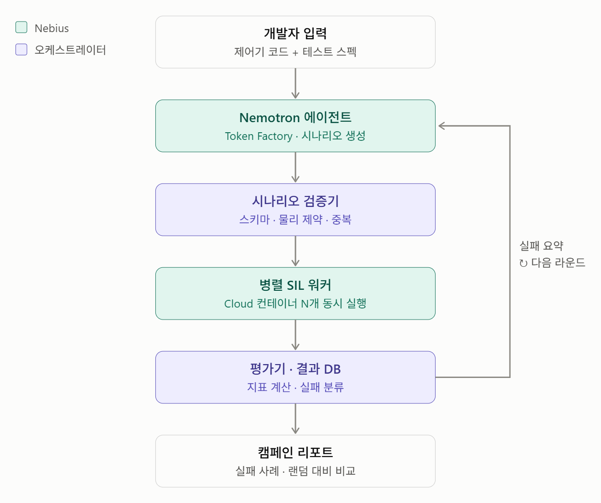
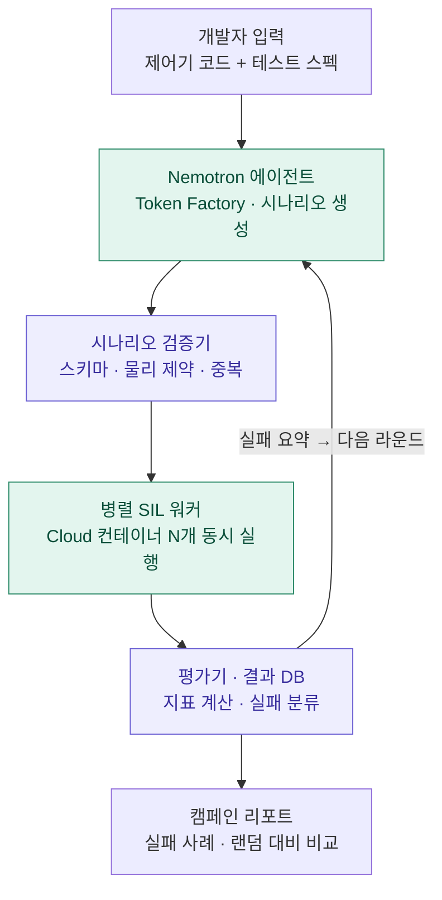

# SIL_HACKATHON

> **LLM 에이전트로 차량 고장 대응 시스템의 숨은 위험 조건을 찾아내고, 실제로 얼마나 안전하게 동작하는지 SIL(Software-in-the-Loop)로 검증하는 시스템**

NVIDIA × Nebius 해커톤 **Physical AI 트랙** 제출 프로젝트입니다.

> 상태: 기획 단계. 아래 구조와 지표는 설계안이며, 구현하면서 바뀔 수 있습니다.

---

## 1. 문제 정의

자동차의 고장 대응 로직(fail-safe / fail-operational)은 "고장이 나면 안전한 상태로 넘어간다"는 전제로 만들어집니다. 하지만 실제로 위험한 순간은 대개 **여러 조건이 겹칠 때** 나타납니다.

- 고속 + 급커브 + 센서 드리프트가 **동시에** 발생
- 제어기 전환이 하필 **조향 입력이 큰 순간**에 일어남
- 통신 지연이 고장 감지 시간과 겹쳐 **대응이 늦어짐**

이런 조건 조합은 경우의 수가 너무 많아서 사람이 시나리오를 손으로 짜거나 무작위로 뽑아서는 놓치기 쉽습니다.

**이 프로젝트의 목표**

1. 고장 대응 시스템에 숨어 있는 **위험한 조건 조합을 자동으로 찾는다**
2. 그 조건에서 시스템이 **얼마나 안전하게 동작하는지 정량적으로 검증한다**
3. 무작위 테스트보다 **더 적은 시뮬레이션으로 더 많은 실패를 찾는다**는 것을 보인다

## 2. 검증 대상: Steer-by-Wire (SbW)

첫 번째 대상은 **Steer-by-Wire** 시스템입니다. SbW는 핸들과 바퀴 사이의 기계적 연결이 없고 전기 신호와 액추에이터로만 조향하므로, 고장 대응 로직이 곧 안전과 직결됩니다.

```
핸들 각도 센서 ──▶ 조향 ECU (제어기) ──▶ 조향 액추에이터 ──▶ 바퀴
                        ▲                                  │
                        └──────── 바퀴 각도 / 차량 상태 ◀──────┘
```

### 다룰 고장 유형

| 구분 | 예시 |
|---|---|
| **센서 고장** | 핸들/바퀴 각도 센서 고착(stuck), 드리프트, 노이즈 증가, 신호 끊김 |
| **액추에이터 고장** | 출력 포화, 응답 지연, 토크 저하 |
| **통신 고장** | 메시지 지연, 패킷 손실 |
| **제어기 고장** | 주 제어기(MPC) 다운 → 백업 제어기(LQR) 전환 |
| **상위 시스템 고장** | 자율주행 스택이 비정상 조향 명령을 내리는 경우 |

### 핵심 시나리오: MPC → LQR 전환

주 제어기인 **MPC**가 연산 시간 초과, 최적화 해 없음(infeasible) 등으로 다운되면 백업 제어기인 **LQR**로 전환합니다. 이 전환 과정에서 다음 위험이 생길 수 있습니다.

- **전환 과도 응답**: 두 제어기의 출력이 달라 조향각이 순간적으로 튀는 현상 (bumpless transfer 실패)
- **감지 지연**: MPC가 멈춘 것을 알아채기까지 걸리는 시간 동안 제어 공백
- **운전 영역 이탈**: LQR은 선형화 기준점 근처에서만 잘 동작하므로, 고속·큰 조향각 상황에서는 성능이 떨어질 수 있음

## 3. 시스템 구조

<p align="center">
  
</p>

같은 구조를 다이어그램으로 나타내면 다음과 같습니다.



🟩 **Nebius 위에서 실행** · 🟪 **오케스트레이터(로컬/서버)에서 실행**

| 단계 | 역할 | 실행 위치 |
|---|---|---|
| **개발자 입력** | 검증할 제어기 코드와 테스트 스펙(차속 범위, 고장 종류, 안전 기준 등)을 넣는다 | — |
| **Nemotron 에이전트** | Nebius Token Factory의 NVIDIA Nemotron 모델이 위험해 보이는 고장 시나리오를 생성한다 | Nebius |
| **시나리오 검증기** | 형식(스키마)이 맞는지, 물리적으로 가능한지, 이미 돌린 시나리오와 겹치지 않는지 확인한다 | 오케스트레이터 |
| **병렬 SIL 워커** | 검증된 시나리오를 클라우드 컨테이너 N개에서 동시에 시뮬레이션한다 | Nebius |
| **평가기 · 결과 DB** | 안전 지표를 계산하고, 실패를 유형별로 분류해 저장한다 | 오케스트레이터 |
| **피드백 루프** | 실패 요약을 에이전트에게 돌려줘 다음 라운드에서 더 위험한 영역을 집중 탐색한다 | — |
| **캠페인 리포트** | 찾은 실패 사례와 무작위 탐색 대비 효율을 정리한다 | — |

### Nebius 활용

| 서비스 | 실제 기능 | 이 프로젝트에서의 사용 |
|---|---|---|
| Token Factory | NVIDIA Nemotron 추론 API | 기존 실패를 분석하고 다음 고장 조건 추론 |
| Token Factory | Tool Calling | 시나리오 생성 도구와 시뮬레이터 실행 요청 |
| Token Factory | 여러 Nemotron 모델 선택 | 분석이 어려운 단계와 단순 생성 단계 분리 |
| AI Cloud | Serverless Jobs | 고장 시나리오별 시뮬레이션 실행 |
| AI Cloud | GPU 컴퓨팅 · 시뮬레이션 인프라 | Isaac Sim 등 GPU 기반 환경으로 확장 |

## 4. 평가 지표 (안)

| 지표 | 의미 |
|---|---|
| 횡방향 오차 | 목표 경로에서 얼마나 벗어났는가 |
| 헤딩 오차 | 차량 방향이 목표와 얼마나 어긋났는가 |
| 요레이트 · 횡가속도 | 차량이 불안정하게 회전하지 않았는가 |
| 조향각 변화율 | 전환 순간 조향이 급격히 튀지 않았는가 |
| 회복 시간 | 고장 후 정상 범위로 돌아오기까지 걸린 시간 |
| 차선 이탈 여부 | 안전 기준을 넘었는가 (최종 합격/불합격) |

**캠페인 수준 지표**: 같은 시뮬레이션 횟수에서 에이전트 방식과 무작위 방식이 각각 찾은 실패 수와 실패 유형의 다양성을 비교합니다.

## 5. 예정 디렉터리 구조

```
SIL_HACKATHON/
├── agent/         # Nemotron 시나리오 생성 · 프롬프트
├── validator/     # 시나리오 스키마 · 물리 제약 검사
├── sil/           # 차량 모델 · SbW 플랜트 · MPC/LQR 제어기 · 고장 주입
├── worker/        # 병렬 실행 컨테이너
├── evaluator/     # 지표 계산 · 실패 분류 · 결과 DB
├── report/        # 캠페인 리포트 생성
└── docs/          # 설계 문서
```

## 6. 로드맵

- [ ] SbW 차량 모델 + MPC/LQR 제어기 SIL 구성
- [ ] 고장 주입 인터페이스 (센서 · 액추에이터 · 통신 · 제어기 전환)
- [ ] 시나리오 스키마와 검증기
- [ ] Nemotron 시나리오 생성 에이전트 연결
- [ ] Nebius 병렬 워커 실행
- [ ] 평가기 · 결과 DB · 피드백 루프
- [ ] 무작위 탐색 대비 비교 실험과 캠페인 리포트
- [ ] 확장: 자율주행 스택 고장 시나리오
