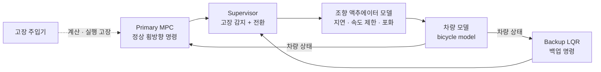
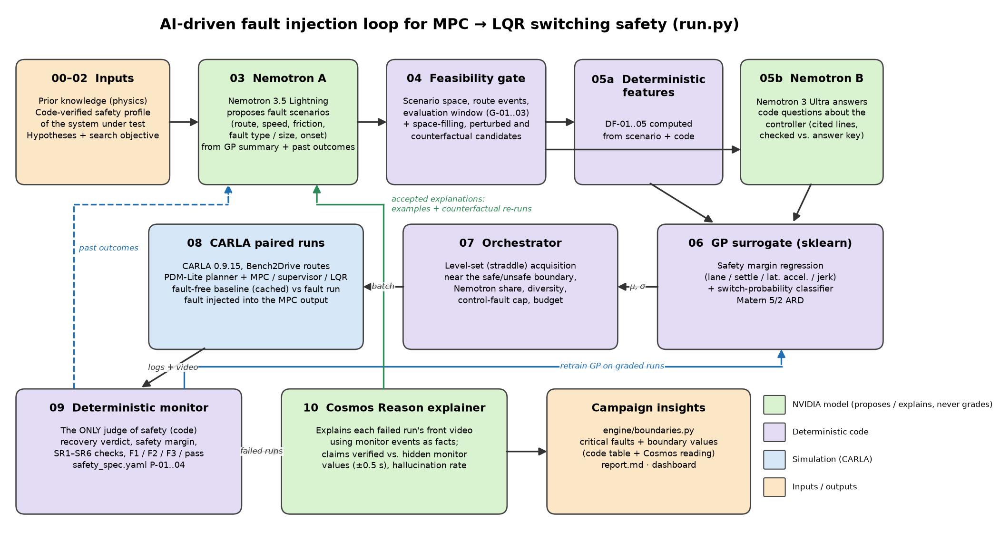
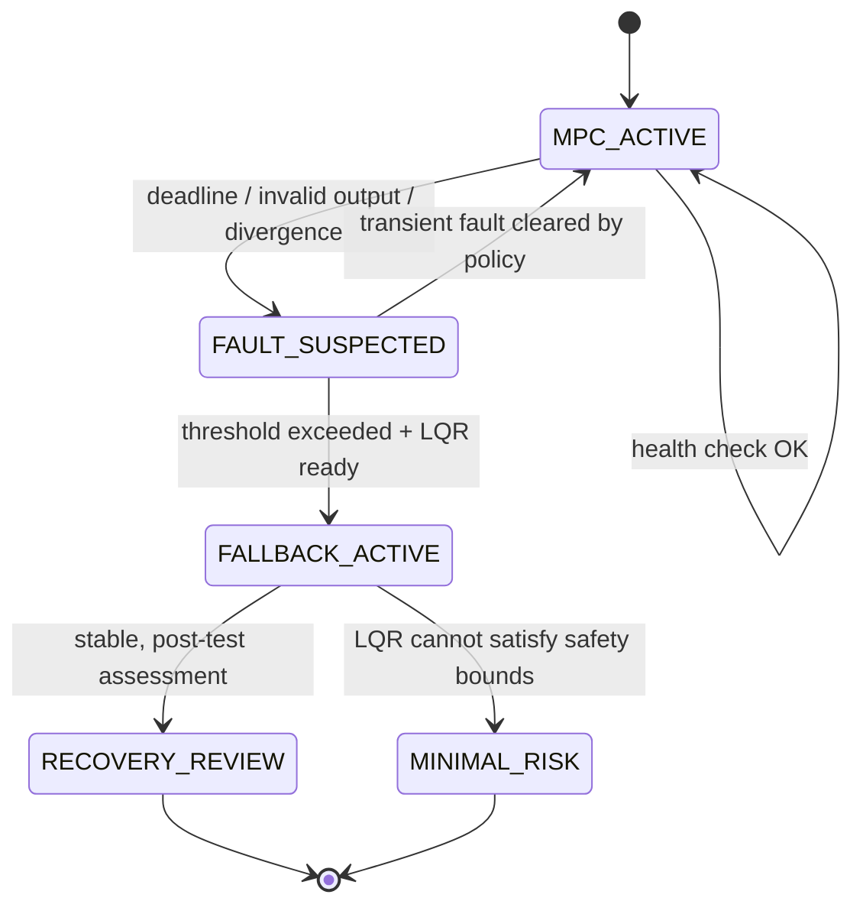
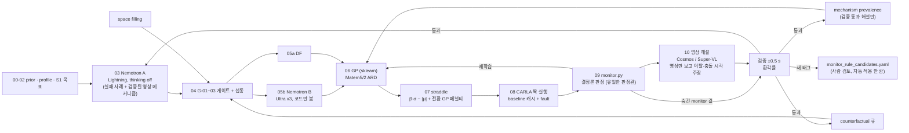

# AI-Driven Fault Injection for Safety Validation of MPC-to-LQR Controller Switching

> **MPC에 다양한 계산 및 실행 고장을 주입하고, 제어기 전환 시점과 차량 동적 상태에 따라 발생하는 안전 위반 조건을 자동으로 탐색 · 검증하는 시스템**
>
> NVIDIA × Nebius 해커톤 **Physical AI 트랙** 제출 프로젝트
>
> **상태 (최종 제출, 브랜치 `inter_final`):** 구현과 CARLA 실험 완료. 최종 캠페인 `result/result_12` (32런 + 이전 117런).
> 시뮬레이션 결과이며 안전 인증은 아닙니다.
>
> **심사위원 안내 / Judges: [JUDGES_GUIDE.md](JUDGES_GUIDE.md)** — 2분 안에 결과 보기, CARLA 없이 1분 실행, 전체 실행 방법, 핵심 결과
> (크리티컬 고장 1. drift, 2. bias; 경계값과 GP 경계 탐색 성능)

[Architecture](docs/ARCHITECTURE.md) · [Research & Evaluation](docs/RESEARCH.md) · [Roadmap](docs/ROADMAP.md) · [Sources](docs/REFERENCES.md)

---

## 1. 프로젝트 개요

차량의 주 횡방향 제어기인 **MPC**가 계산 시간 초과, 실행 중단, 잘못된 출력 같은 고장을 일으키면 Supervisor가 이를 감지해 백업 제어기인 **LQR**로 제어권을 넘깁니다. 이 전환이 안전한지는 **언제, 어떤 차량 상태에서** 전환이 일어나느냐에 크게 좌우됩니다.

- 차가 커브에 진입한 순간 MPC 계산이 지연됨
- 전환이 하필 **요레이트 · 조향각이 큰 순간**에 일어나 두 제어기 출력 차이가 커짐
- 감지 지연과 높은 차속이 겹쳐 **제어 공백이 길어짐**

이런 고장 × 전환 시점 × 차량 상태 조합은 경우의 수가 너무 많아 사람이 손으로 짜거나 무작위로 뽑아서는 놓치기 쉽습니다. 이 프로젝트는 NVIDIA **Nemotron** 기반 에이전트가 이전 시험 결과를 분석해 다음 고장 시나리오를 제안하고, **Nebius** 클라우드에서 SIL 시뮬레이션을 병렬로 돌려 안전 위반 조건을 찾아냅니다. **안전 여부 판정은 LLM이 아니라 결정론적 코드가 담당합니다.**

**핵심 연구 질문**

> 같은 시뮬레이션 예산에서, AI 기반 고장 주입 프레임워크가 무작위·격자 탐색보다 안전에 치명적인 MPC → LQR 전환 실패를 더 효율적으로 찾을 수 있는가?

## 2. 검증 대상과 범위

### 검증 대상: MPC → LQR 제어기 전환



고장은 **MPC에만** 주입합니다. 조향 액추에이터 모델은 고장 주입 대상이 아니라 차량 동역학의 일부로, 전환 순간의 차량 동적 상태를 현실적으로 만드는 역할을 합니다.

> 배경: Steer-by-Wire(SbW)처럼 핸들과 바퀴 사이에 기계적 연결이 없는 조향 시스템에서는 제어기가 잘못돼도 운전자가 핸들로 대신 버틸 수 없어, 제어기 전환의 안전성이 특히 중요합니다.

### 범위

| 구분 | 내용 |
|---|---|
| **포함** | MPC 계산 · 실행 고장 주입, Supervisor 전환, LQR 백업 제어, 전환 시점과 차량 동적 상태에 따른 안전 위반 탐색 |
| **포함하지 않음** | 센서 · 액추에이터 · 통신 등 하드웨어 고장 주입, SbW 이중화 모터 · ECU 검증, 하드웨어 안전 인증 |

> MPC → LQR은 양산차의 표준 조합이 아니라 **연구 · 시험용 예시 제어기**입니다. 알고리즘 백업은 센서 · 전원 · 모터 · ECU의 물리적 고장을 해결하지 못하며, 하드웨어 이중화를 의미하지 않습니다.

## 3. 시스템 구조

<p align="center">
  
</p>

단계별 설정 파일은 [pipeline/README.md](pipeline/README.md)에 정리되어 있습니다.

| 구성요소 | 역할 | 경계 |
|---|---|---|
| **개발자 입력** | 검증할 제어기 코드(`primary_controller.py`, `fallback_controller.py`, `supervisor.py`)와 테스트 스펙(`test_spec.yaml`) | — |
| **Nemotron 에이전트** 🟩 | 이전 시험 결과 분석, 위험 조건 가설, 다음 시나리오 후보 제안 | 안전 여부 최종 판정 **금지** |
| **시나리오 검증기** 🟪 | JSON 스키마, 물리적 허용 범위, 중복, 예산 검사 | 잘못된 LLM 출력을 실험에 넣지 않음 |
| **병렬 SIL 워커** 🟩 | 차량 동역학 · 제어기 · 고장 주입 · 주행 로그 생성 | 클라우드 배포 · CARLA 연동은 구현 예정 |
| **평가기 · 결과 DB** 🟪 | 횡오차, 경계 침범, 전환 시간, 조향 불연속 계산 및 실패 분류 | 사전에 정한 수학적 기준으로만 판정 |
| **피드백 루프** | 실패 요약과 미탐색 영역을 다음 라운드 에이전트 입력으로 반영 | 탐색 성능 우위는 실험으로 검증 필요 |
| **캠페인 리포트** | 실패 사례, 무작위 대비 발견 효율 비교 | — |

### Nebius 활용

| 서비스 | 실제 기능 | 이 프로젝트에서의 사용 |
|---|---|---|
| Token Factory | NVIDIA Nemotron 추론 API | 기존 실패를 분석하고 다음 고장 조건 추론 |
| Token Factory | Tool Calling | 시나리오 생성 도구와 시뮬레이터 실행 요청 |
| Token Factory | 여러 Nemotron 모델 선택 | 분석이 어려운 단계와 단순 생성 단계 분리 |
| AI Cloud | Serverless Jobs | 고장 시나리오별 시뮬레이션 실행 |
| AI Cloud | GPU 컴퓨팅 · 시뮬레이션 인프라 | Isaac Sim 등 GPU 기반 환경으로 확장 |

사용 가능한 Nemotron 모델 ID는 계정에서 `GET /v1/models`로 확인한 뒤 정합니다. 자세한 인터페이스는 [docs/ARCHITECTURE.md](docs/ARCHITECTURE.md)에 있습니다.

## 4. 제어기 전환 흐름



전환 과정에서 확인할 위험:

- **전환 과도 응답:** 두 제어기의 출력 차이로 조향각이 순간적으로 튀는 현상 (bumpless transfer 실패)
- **감지 지연:** MPC 이상을 알아채기까지의 제어 공백
- **운전 영역 이탈:** LQR은 선형화 기준점 근처에서만 잘 동작하므로 고속·큰 조향각에서 성능 저하 가능

> 이 상태도는 시험 대상인 **제안 로직**입니다. `MINIMAL_RISK`는 목표 상태일 뿐 안전하게 도달함을 입증한 것이 아닙니다. 제어기 재전환(re-entry)은 MVP 범위에서 제외합니다.

## 5. 시험할 고장과 변수

| 종류 | 고장 주입 예시 | 검증 대상 |
|---|---|---|
| 계산 시간 초과 | MPC update deadline 초과 | 탐지 · 전환 지연 |
| 실행 중단 | MPC 계산/출력 중지 | LQR 활성화 및 궤적 오차 |
| 잘못된 출력 | 조향 명령 bias / 부호 오류 / 포화 | 출력 유효성 검사 · 조향 급변 |
| 출력 지연 | 이전 시점 조향 명령 유지 | stale command 대응 |

**시나리오 변수 (입력)**

| 구분 | 변수 |
|---|---|
| 고장 | 고장 종류, 발생 시점, 강도, 지속시간 |
| 전환 시점 | Supervisor 감지 지연, 감지 임계값 · debounce, LQR 초기화 상태 |
| 주행 조건 | 초기 차속, 도로 곡률, 초기 횡방향 · 헤딩 오차, 노면 마찰(선택) |

**전환 순간 차량 동적 상태 (기록 · 분석)**

LQR이 제어권을 넘겨받는 순간의 상태를 매 실행마다 기록해, 어떤 상태에서 전환이 일어날 때 안전 위반이 생기는지 분석합니다.

| 상태 | 의미 |
|---|---|
| 요레이트 · 횡가속도 · 횡슬립각 | 차량이 얼마나 급하게 회전 중이었나 |
| 조향각 · 조향 속도 | 전환 순간 조향 입력 크기 |
| 횡방향 · 헤딩 오차 | 이미 경로에서 얼마나 벗어나 있었나 |
| **MPC − LQR 출력 차이** | 전환 직후 조향 명령이 얼마나 튈 수 있나 |

예시는 [`configs/scenario.example.yaml`](configs/scenario.example.yaml)에 있습니다.

## 6. 측정 지표

LLM이 "안전하다"고 추측하지 않도록, 실행 로그로 수치를 계산합니다. 수식과 정의는 [docs/RESEARCH.md](docs/RESEARCH.md)에 있습니다.

| 지표 | 정의 |
|---|---|
| **Maximum lateral error** | 기준 경로 대비 최대 절대 횡방향 오차 (m) |
| **Lane boundary violation** | 차량 외곽이 차선 경계를 넘었는지 (bool / count) |
| **Steering discontinuity** | 적용 조향각의 연속 샘플 차이 최대값 (rad) |
| **Detection / Handover latency** | 고장 발생 → 탐지 → LQR 인계까지 걸린 시간 (s) |
| **Recovery time** | 허용 오차 안으로 들어와 일정 시간 유지되기까지 걸린 시간 (s) |
| **State-at-switch failure map** | 전환 순간 차량 상태 공간에서 안전 위반이 생기는 영역 |
| **Failure discovery rate** | 고정 예산에서 기준을 위반한 시나리오 비율 |
| **Unique failure coverage** | 중복을 제거한 실패 유형 · 조건 그룹 수 |
| **Trials to first failure** | 첫 유효 실패를 찾기까지 시뮬레이션 횟수 |

수치 임계값(`allowed_lateral_error_m`, `max_steering_rate_rad_s`, `recovery_hold_s` 등)은 아직 정하지 않았으며, **실험 전에 고정하고 공개합니다.**

## 7. 비교 실험 설계

같은 차량 모델, 고장 파라미터 공간, 시드, 시뮬레이션 예산으로 비교합니다.

1. **Random search:** 범위 안에서 무작위 선택
2. **Grid / stratified search:** 미리 정한 격자 · 층화 표본
3. **LLM one-shot (선택):** 피드백 없이 Nemotron으로 생성
4. **Feedback-guided Nemotron:** 이전 실패 로그와 커버리지를 반영해 다음 시나리오 선택

여러 시드로 반복해 예산별 누적 고유 실패 곡선, 첫 실패까지 시도 횟수, 실패 다양성, 연산 비용을 보고합니다. **현재 결과는 없습니다.**

## 8. 데모 시나리오 (계획)

1. 사용자가 제어기 코드와 `test_spec.yaml`을 넣거나 기본 예시를 고른다.
2. 에이전트가 1차 시나리오를 만들고 검증기가 검사한다.
3. 병렬 워커에서 MPC 고장을 주입하고 LQR 전환을 실행한다.
4. 로그 · 리플레이 · 안전 지표를 기록하고 실패를 분류한다.
5. 에이전트가 실패 요약을 받아 다음 배치를 만든다.
6. 비교군 대비 발견 성능과 실패 장면을 리포트로 보여준다.

**예상 결과물:** SIL 애니메이션(또는 CARLA 주행 영상), 횡오차 · 조향 명령 시계열, 전환 이벤트 타임라인, **전환 순간 상태별 안전 위반 지도**, 실패 조건 표와 요약 리포트.

## 9. 저장소 구조

```text
SIL_HACKATHON/
├── README.md
├── docs/
│   ├── ARCHITECTURE.md            # 모듈 · 데이터 흐름 · 인터페이스
│   ├── RESEARCH.md                # 가설 · 지표 · 베이스라인 · 한계
│   ├── ROADMAP.md                 # 구현 단계 체크리스트
│   └── REFERENCES.md              # 공식 문서 · 출처
├── pipeline/                      # code-aware 탐색 파이프라인 (단계별 설정, pipeline/README.md 참고)
│   ├── 00_prior_knowledge/        # 물리 관계 · 검증 전 가설 (PK)
│   ├── 01_safety_profile/         # 코드 관측 사실
│   ├── 02_hypotheses/             # 지표 정의 + search_objectives/ (S1~S4 탐색 목표, A 분석층, R 회귀). 옛 H-01~11은 superseded
│   ├── 03_nemotron_a/             # Nemotron A: 시나리오 생성
│   ├── 04_feasibility_expansion/  # 타당성 검사 G-01~04 + 후보 확장, scenario space
│   ├── 05a_deterministic_features/# DF-01~05
│   ├── 05b_nemotron_b/            # Nemotron B: 코드 질문
│   ├── 06_gp_surrogate/           # 지표별 GP (정규화 z)
│   ├── 07_orchestrator/           # LCB 선택 · 예산
│   ├── 08_carla_paired_run/       # baseline vs fault 짝 실행
│   ├── 09_monitor/                # safety spec P-01~04 + SR1/2/4/6 수치 + error table (판정 코드는 engine/monitor.py · sr_checks.py)
│   ├── 10_video_explainer/        # 영상 해설 + 검증 (Cosmos Reason / Nemotron VL)
│   ├── llm_models.yaml            # 모델 id · 호출 파라미터 (역할 A, A_refine, B, C)
│   └── evaluation/                # ablation X-1~6
├── engine/                        # 실행 코드 전부 (pipeline/ 에는 단계 설정만 둔다)
│   ├── judgment.py · monitor.py   # 판정 순수 함수 · 09 모니터 evaluate() (CLI: python -m engine.monitor RUN_DIR --baseline DIR)
│   ├── sr_checks.py · dashboard.py# 팀원 Monitor v2의 SR1/SR2/SR4/SR6 검사 · 진행 화면 (outputs/<run>/screen/campaign.html)
│   ├── fault_catalog.py · fault_args.py · av_stack_probe.py  # av_stack 고장 목록 검증 · run_benchmark 인자 · CARLA 차선 probe
│   ├── config.py · config_check.py# YAML·av_stack 경로 해석 · null 항목 점검 (python run.py --check)
│   ├── surrogate.py · scenarios.py · nemotron.py · llm.py · carla_runner.py · video.py · explainer.py · feedback.py
│   ├── fixtures/                  # mock 전용 합성 시뮬레이터 · scenario space (SYNTHETIC)
│   ├── hypothesis_tools/          # 가설 생성기 · 후보 샘플러 (+ examples/)
│   └── prior_tools/               # Nemotron prior payload · 횡가속도 스크리닝
├── run.py                         # 한 번에 실행: python run.py --mock | --real | --check
├── tests/                         # python -m pytest -q (unittest 테스트 포함)
├── requirements-pipeline.txt      # 루프용 패키지 (CARLA는 sim-eval .venv-tfpp)
├── configs/
│   └── scenario.example.yaml      # 시나리오 스펙 예시 (실행 설정 아님)
├── examples/
│   └── test-result.example.json   # 결과 스키마 예시 (실측 아님)
├── .github/
│   └── ISSUE_TEMPLATE.md
├── .env.example                   # API 키 자리 (실제 키는 커밋 금지)
└── .gitignore
```

## 10. 구현 순서

- **Phase 1 — Minimal SIL:** bicycle model + 조향 액추에이터 모델 + MPC / LQR + supervisor + MPC 고장 주입기 + JSON 로그 (전환 순간 상태 포함)
- **Phase 2 — Reproducible evaluation:** 평가기, 무작위 / 격자 베이스라인, seed · config 기록
- **Phase 3 — Agent loop:** Token Factory Nemotron 연결, 출력 스키마 검증, 피드백 기반 탐색
- **Phase 4 — Parallelization:** 실험 큐 · 워커, Nebius AI Cloud 병렬 실행
- **Phase 5 — Analysis & demo:** 전환 순간 상태별 안전 위반 지도, 실패 리플레이, 리포트. 여유가 있으면 CARLA / Isaac Sim

세부 체크리스트는 [docs/ROADMAP.md](docs/ROADMAP.md)에 있습니다.

## 11. 한계

고장은 MPC의 계산 · 실행 고장만 다루며, 센서 · 액추에이터 등 하드웨어 고장은 범위 밖입니다. 이 프로젝트는 시뮬레이션 기반 연구 도구이며 실제 차량용 소프트웨어나 ISO 26262 인증 도구가 아닙니다. 하나의 시뮬레이터 · 차량 모델 결과를 실제 차량 안전 보장으로 일반화할 수 없습니다. MPC와 LQR이 같은 센서나 ECU를 공유하면 알고리즘 백업만으로는 하드웨어 고장을 막지 못합니다. **실패를 찾지 못했다고 해서 안전이 증명되는 것은 아닙니다.**

## 12. 한 번에 실행하기 (`python run.py`, 2026-10-27)

`new_pipeline` + `junwoo/sim-eval` 을 main 에 병합하면 `pipeline/08_carla_paired_run/av_stack/` 와
`pipeline/04_feasibility_expansion/scenario_space_av_stack.yaml` 이 생기고, 루프가 그것을 자동으로 찾는다.
병합 전에는 `SIM_EVAL_ROOT`(sim-eval 체크아웃) 또는 `AV_STACK_ROOT` 로 위치를 알려준다.

### 설치

```powershell
# Windows (저장소 루트). 루프용 venv. CARLA 실행은 sim-eval 의 .venv-tfpp 가 맡는다.
py -3.11 -m venv .venv-sil
.venv-sil\Scripts\pip install -r requirements-pipeline.txt
```

### mock 모드 (CARLA·네트워크 없음, 합성 데이터)

```powershell
.venv-sil\Scripts\python run.py --mock                      # 00 → 10 전체, outputs\mock_<시각>\
.venv-sil\Scripts\python run.py --mock --ablation-suite      # X-1,2,3,5,6 비교 (SYNTHETIC)
.venv-sil\Scripts\python -m pytest -q
.venv-sil\Scripts\python run.py --check                     # 단계 YAML null 항목 보고 (남아 있으면 exit 2)
.venv-sil\Scripts\python -m engine.monitor RUN_DIR --baseline BASE_DIR   # 런 폴더 하나만 판정
```

`python -m run ...` 도 같다. 실행 코드는 전부 `engine/`, 단계 설정(YAML)은 `pipeline/` 에 있다.

mock 은 `engine/fixtures/synthetic_sim.py`(운동학 근사 시뮬레이터, 320x180 합성 영상)와 stub LLM 을 쓴다.
모든 파일에 `synthetic_fixture: true` 가 붙고 보고서에 SYNTHETIC 이 표시된다. **수치는 실측이 아니다.**

### real 모드 (CARLA 0.9.15 + Nebius Token Factory)

```powershell
# 1) CARLA 서버 (sim-eval av_stack 폴더)
cd pipeline\08_carla_paired_run\av_stack ; .\start_carla_stable.ps1 ; cd ..\..\..
# 2) 키: .env 에 NEBIUS_API_KEY=... (커밋 금지) 또는
$env:NEBIUS_API_KEY = "..."
# 3) 점검 → 실행
.venv-sil\Scripts\python run.py --real --check
.venv-sil\Scripts\python run.py --real                       # 기본: X-5 + 영상 해설 on (= X-6)
.venv-sil\Scripts\python run.py --real --ablation X-3 --video-explainer off --rounds 2
```

| 환경 변수 | 뜻 |
|---|---|
| `NEBIUS_API_KEY` | Token Factory 키 (필수, 출력·로그에 남기지 않음) |
| `NEMOTRON_A_MODEL_ID`, `NEMOTRON_B_MODEL_ID` | 모델 id 덮어쓰기 (기본값 `pipeline/llm_models.yaml`) |
| `COSMOS_MODEL_ID`, `COSMOS_BASE_URL`, `COSMOS_API_KEY` | Cosmos Reason Dedicated Endpoint. 없으면 `nvidia/Nemotron-3.5-Super-VL` 로 대체 |
| `AV_STACK_ROOT` / `SIM_EVAL_ROOT` | 병합 전 av_stack 위치 |
| `AV_STACK_PYTHON` | carla 를 import 할 수 있는 python (기본 `av_stack\.venv-tfpp\Scripts\python.exe`) |
| `CARLA_HOST`, `CARLA_PORT` | 기본 localhost:2000 |
| `FFMPEG` | ffmpeg 경로 (없으면 PATH → imageio-ffmpeg) |

Windows 메모: 경로에 공백이 있어도 된다(subprocess 리스트 인자). ffmpeg glob 을 쓰지 않는다. CARLA 는 1대만 쓴다
(`parallel_workers: 1`). 각 런의 `--out` 은 새 폴더여야 하므로 `outputs\...\runs\R..` 를 매번 새로 만든다.

### 루프



역할 분리: A 만 실패 사례를 본다 · B 는 코드만 본다 · 해설기는 영상과 맥락(고장·전환 시각)만 보고
이탈·충돌·오프셋은 못 본다 · 판정은 09 monitor 만 한다. 해설이 판정을 바꾸지 않는다.

### 출력 (`outputs/<mode>_<시각>/`)

`run_records.jsonl`, `failure_table.jsonl`, `explanations.jsonl`, `monitor_rule_candidates.yaml`,
`evaluation_metrics.json`(경계 양쪽 관측, |robustness|<0.2 런 수, GP 경계 부호 정확도, 첫 실패까지 런 수,
고유 실패 조건, 해설 통과율), `llm_calls.jsonl`(토큰 사용량, 키 없음), `report.md`, `round_xx/`, `runs/`, `clips/`.

### PROVISIONAL 값 (사용자 확인 전)

복구 판정 0.3 m / 0.1 rad / 1 s / 3 s / 4.41 m/s² / 5 m/s³ (팀원 기준, 09 safety_spec.yaml), onset 이벤트 검출 κ 1/60·1/300 m⁻¹, fault 런
`--stop-after-fault 15`, 속도 격자 5 km/h, 예산 72 런(cold 24 + 12×4), straddle β 1.96, 해설 선택 |robustness|<0.15.
