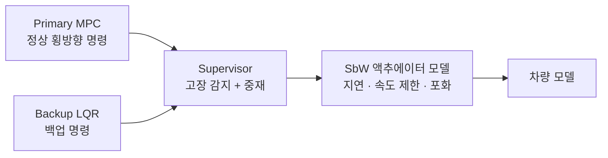
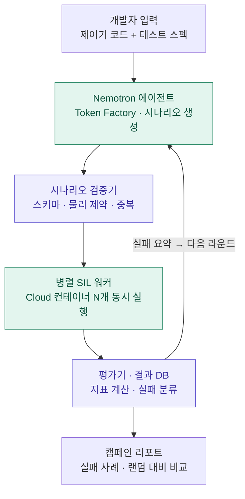
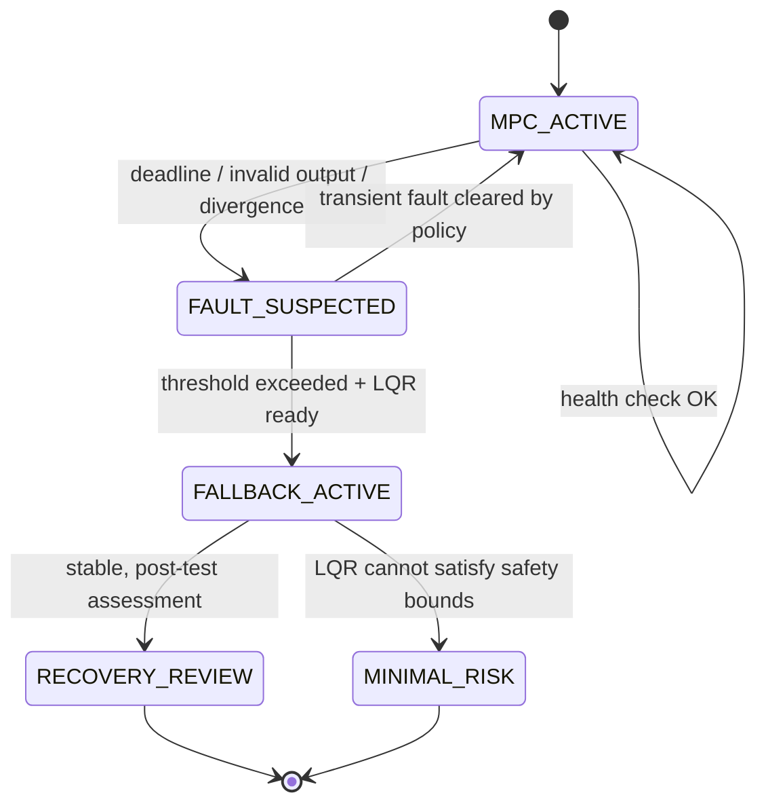

# SIL_HACKATHON — AI-Driven Fault Injection & Recovery Testing

> **LLM 에이전트로 차량 고장 대응 시스템의 숨은 위험 조건을 찾아내고, 실제로 얼마나 안전하게 동작하는지 SIL(Software-in-the-Loop)로 검증하는 시스템**
>
> NVIDIA × Nebius 해커톤 **Physical AI 트랙** 제출 프로젝트
>
> **상태:** 연구 구상 · 구현 계획 단계. **실험 결과나 안전 인증은 아직 없습니다.**

[Architecture](docs/ARCHITECTURE.md) · [Research & Evaluation](docs/RESEARCH.md) · [Roadmap](docs/ROADMAP.md) · [Sources](docs/REFERENCES.md)

---

## 1. 프로젝트 개요

자동차의 고장 대응 로직(fail-safe / fail-operational)은 "고장이 나면 안전한 상태로 넘어간다"는 전제로 만들어집니다. 하지만 위험은 대개 **여러 조건이 겹칠 때** 나타납니다.

- 차가 커브에 진입한 순간 주 제어기 계산이 지연됨
- 제어기 전환이 하필 **조향 입력이 큰 순간**에 일어남
- 고장 감지 지연과 높은 차속이 겹쳐 **대응이 늦어짐**

이런 조건 조합은 경우의 수가 너무 많아 사람이 손으로 짜거나 무작위로 뽑아서는 놓치기 쉽습니다. 이 프로젝트는 NVIDIA **Nemotron** 기반 에이전트가 이전 시험 결과를 분석해 다음 고장 시나리오를 제안하고, **Nebius** 클라우드에서 SIL 시뮬레이션을 병렬로 돌려 위험 조건을 찾아내는 프레임워크를 만듭니다. **안전 여부 판정은 LLM이 아니라 결정론적 코드가 담당합니다.**

**핵심 연구 질문**

> 같은 시뮬레이션 예산에서, AI 기반 고장 주입 프레임워크가 무작위·격자 탐색보다 안전에 치명적인 MPC → LQR 전환 실패를 더 효율적으로 찾을 수 있는가?

## 2. 검증 대상과 범위

### 왜 Steer-by-Wire (SbW)인가

SbW는 핸들과 바퀴 사이에 기계적 연결 없이 전기 신호와 액추에이터로만 조향합니다. 조향 제어기가 잘못되면 **운전자가 핸들로 대신 버틸 기계적 백업이 없기 때문에**, 제어기 고장 대응을 검증하는 일이 안전의 핵심이 됩니다. 이 프로젝트는 SbW 차량을 배경으로 삼아 **조향 제어기의 고장 대응**을 검증합니다.

### 어느 층을 다루는가

```
① 자율주행 계획기   "이 경로로 가라"
        ↓  목표 경로
② 조향 제어기       MPC (주) / LQR (백업) + Supervisor   ← 핵심 검증 대상
        ↓  조향각 명령
③ SbW 조향 시스템   각도 센서 · 액추에이터              ← 단순 모델로 포함
        ↓
④ 차량              bicycle model
```

- **②층:** MPC 고장 → LQR 전환이 이 프로젝트의 핵심입니다. MPC 횡방향 제어기 자체가 자율주행 스택의 일부이므로, ①층을 따로 다루지는 않습니다.
- **③층:** SbW 액추에이터를 응답 지연 · 속도 제한 · 포화가 있는 단순 모델로 넣습니다. 이 모델의 파라미터를 바꾸는 것만으로 SbW 쪽 고장을 MPC 고장과 **겹쳐서** 시험할 수 있습니다.

### 범위

| 구분 | 내용 |
|---|---|
| **핵심 (필수)** | MPC 고장 → LQR 전환 시험. 차량 모델에 단순한 SbW 액추에이터 모델 포함 |
| **조합 고장 (가능하면)** | MPC 고장과 SbW 액추에이터 지연 · 포화, 각도 센서 노이즈가 **동시에** 생기는 경우 |
| **하지 않음** | SbW 이중화 모터 · ECU 검증, 하드웨어 안전 인증 |

> MPC → LQR은 양산차의 표준 조합이 아니라 **연구 · 시험용 예시 제어기**입니다. 알고리즘 백업은 센서 · 전원 · 모터 · ECU의 물리적 고장을 해결하지 못하며, 하드웨어 이중화를 의미하지 않습니다.



## 3. 시스템 구조



🟩 **Nebius 위에서 실행** · 🟪 **오케스트레이터에서 실행**

| 구성요소 | 역할 | 경계 |
|---|---|---|
| **개발자 입력** | 검증할 제어기 코드(`primary_controller.py`, `fallback_controller.py`, `supervisor.py`)와 테스트 스펙(`test_spec.yaml`) | — |
| **Nemotron 에이전트** 🟩 | 이전 시험 결과 분석, 위험 조건 가설, 다음 시나리오 후보 제안 | 안전 여부 최종 판정 **금지** |
| **시나리오 검증기** 🟪 | JSON 스키마, 물리적 허용 범위, 중복, 예산 검사 | 잘못된 LLM 출력을 실험에 넣지 않음 |
| **병렬 SIL 워커** 🟩 | 차량 동역학 · 제어기 · 고장 주입 · 주행 로그 생성 | 클라우드 배포 · CARLA 연동은 구현 예정 |
| **평가기 · 결과 DB** 🟪 | 횡오차, 경계 침범, 전환 시간, 조향 불연속 계산 및 실패 분류 | 사전에 정한 수학적 기준으로만 판정 |
| **피드백 루프** | 실패 요약과 미탐색 영역을 다음 라운드 에이전트 입력으로 반영 | 탐색 성능 우위는 실험으로 검증 필요 |
| **캠페인 리포트** | 실패 사례, 무작위 대비 발견 효율 비교 | — |

### Nebius 활용

| 서비스 | 실제 기능 | 이 프로젝트에서의 사용 |
|---|---|---|
| Token Factory | NVIDIA Nemotron 추론 API | 기존 실패를 분석하고 다음 고장 조건 추론 |
| Token Factory | Tool Calling | 시나리오 생성 도구와 시뮬레이터 실행 요청 |
| Token Factory | 여러 Nemotron 모델 선택 | 분석이 어려운 단계와 단순 생성 단계 분리 |
| AI Cloud | Serverless Jobs | 고장 시나리오별 시뮬레이션 실행 |
| AI Cloud | GPU 컴퓨팅 · 시뮬레이션 인프라 | Isaac Sim 등 GPU 기반 환경으로 확장 |

사용 가능한 Nemotron 모델 ID는 계정에서 `GET /v1/models`로 확인한 뒤 정합니다. 자세한 인터페이스는 [docs/ARCHITECTURE.md](docs/ARCHITECTURE.md)에 있습니다.

## 4. 제어기 전환 흐름



전환 과정에서 확인할 위험:

- **전환 과도 응답:** 두 제어기의 출력 차이로 조향각이 순간적으로 튀는 현상 (bumpless transfer 실패)
- **감지 지연:** MPC 이상을 알아채기까지의 제어 공백
- **운전 영역 이탈:** LQR은 선형화 기준점 근처에서만 잘 동작하므로 고속·큰 조향각에서 성능 저하 가능

> 이 상태도는 시험 대상인 **제안 로직**입니다. `MINIMAL_RISK`는 목표 상태일 뿐 안전하게 도달함을 입증한 것이 아닙니다. 제어기 재전환(re-entry)은 MVP 범위에서 제외합니다.

## 5. 시험할 고장과 변수

| 종류 | 고장 주입 예시 | 검증 대상 |
|---|---|---|
| 계산 시간 초과 | MPC update deadline 초과 | 탐지 · 전환 지연 |
| 실행 중단 | MPC 계산/출력 중지 | LQR 활성화 및 궤적 오차 |
| 잘못된 출력 | 조향 명령 bias / 부호 오류 / 포화 | 출력 유효성 검사 · 조향 급변 |
| 출력 지연 | 이전 시점 조향 명령 유지 | stale command 대응 |
| 전환 로직 오류 | supervisor 감지 지연 | 고장 후 안전 상태까지 걸리는 시간 |
| SbW 액추에이터 (조합) | 응답 지연 증가 · 속도 제한 · 포화 | MPC 고장과 겹쳤을 때 전환 성능 |
| SbW 각도 센서 (조합) | 노이즈 · 드롭아웃 · 고착 | 두 제어기의 공통 입력 의존성 |

**시나리오 차원:** 초기 차속, 도로 곡률, 고장 발생 시점, 고장 강도/지속시간, 감지 지연, 초기 횡방향 오차, 백업 제어기 초기화 상태, SbW 액추에이터 지연 · 포화 수준, 노면 마찰(선택). 예시는 [`configs/scenario.example.yaml`](configs/scenario.example.yaml)에 있습니다.

## 6. 측정 지표

LLM이 "안전하다"고 추측하지 않도록, 실행 로그로 수치를 계산합니다. 수식과 정의는 [docs/RESEARCH.md](docs/RESEARCH.md)에 있습니다.

| 지표 | 정의 |
|---|---|
| **Maximum lateral error** | 기준 경로 대비 최대 절대 횡방향 오차 (m) |
| **Lane boundary violation** | 차량 외곽이 차선 경계를 넘었는지 (bool / count) |
| **Steering discontinuity** | 적용 조향각의 연속 샘플 차이 최대값 (rad) |
| **Detection / Handover latency** | 고장 발생 → 탐지 → LQR 인계까지 걸린 시간 (s) |
| **Recovery time** | 허용 오차 안으로 들어와 일정 시간 유지되기까지 걸린 시간 (s) |
| **Failure discovery rate** | 고정 예산에서 기준을 위반한 시나리오 비율 |
| **Unique failure coverage** | 중복을 제거한 실패 유형 · 조건 그룹 수 |
| **Trials to first failure** | 첫 유효 실패를 찾기까지 시뮬레이션 횟수 |

수치 임계값(`allowed_lateral_error_m`, `max_steering_rate_rad_s`, `recovery_hold_s` 등)은 아직 정하지 않았으며, **실험 전에 고정하고 공개합니다.**

## 7. 비교 실험 설계

같은 차량 모델, 고장 파라미터 공간, 시드, 시뮬레이션 예산으로 비교합니다.

1. **Random search:** 범위 안에서 무작위 선택
2. **Grid / stratified search:** 미리 정한 격자 · 층화 표본
3. **LLM one-shot (선택):** 피드백 없이 Nemotron으로 생성
4. **Feedback-guided Nemotron:** 이전 실패 로그와 커버리지를 반영해 다음 시나리오 선택

여러 시드로 반복해 예산별 누적 고유 실패 곡선, 첫 실패까지 시도 횟수, 실패 다양성, 연산 비용을 보고합니다. **현재 결과는 없습니다.**

## 8. 데모 시나리오 (계획)

1. 사용자가 제어기 코드와 `test_spec.yaml`을 넣거나 기본 예시를 고른다.
2. 에이전트가 1차 시나리오를 만들고 검증기가 검사한다.
3. 병렬 워커에서 MPC 고장을 주입하고 LQR 전환을 실행한다.
4. 로그 · 리플레이 · 안전 지표를 기록하고 실패를 분류한다.
5. 에이전트가 실패 요약을 받아 다음 배치를 만든다.
6. 비교군 대비 발견 성능과 실패 장면을 리포트로 보여준다.

**예상 결과물:** SIL 애니메이션(또는 CARLA 주행 영상), 횡오차 · 조향 명령 시계열, 전환 이벤트 타임라인, 실패 조건 표와 요약 리포트.

## 9. 저장소 구조

```text
SIL_HACKATHON/
├── README.md
├── docs/
│   ├── ARCHITECTURE.md            # 모듈 · 데이터 흐름 · 인터페이스
│   ├── RESEARCH.md                # 가설 · 지표 · 베이스라인 · 한계
│   ├── ROADMAP.md                 # 구현 단계 체크리스트
│   └── REFERENCES.md              # 공식 문서 · 출처
├── configs/
│   └── scenario.example.yaml      # 시나리오 스펙 예시 (실행 설정 아님)
├── examples/
│   └── test-result.example.json   # 결과 스키마 예시 (실측 아님)
├── .github/
│   └── ISSUE_TEMPLATE.md
├── .env.example                   # API 키 자리 (실제 키는 커밋 금지)
└── .gitignore
```

## 10. 구현 순서

- **Phase 1 — Minimal SIL:** bicycle model + SbW 액추에이터 모델 + MPC / LQR + supervisor + 고장 주입기 + JSON 로그
- **Phase 2 — Reproducible evaluation:** 평가기, 무작위 / 격자 베이스라인, seed · config 기록
- **Phase 3 — Agent loop:** Token Factory Nemotron 연결, 출력 스키마 검증, 피드백 기반 탐색
- **Phase 4 — Parallelization:** 실험 큐 · 워커, Nebius AI Cloud 병렬 실행
- **Phase 5 — 조합 고장 & demo:** MPC 고장 + SbW 액추에이터 · 센서 고장 동시 시험, 리포트. 여유가 있으면 CARLA / Isaac Sim

세부 체크리스트는 [docs/ROADMAP.md](docs/ROADMAP.md)에 있습니다.

## 11. 한계

이 프로젝트는 시뮬레이션 기반 연구 도구이며 실제 차량용 소프트웨어나 ISO 26262 인증 도구가 아닙니다. 하나의 시뮬레이터 · 차량 모델 결과를 실제 차량 안전 보장으로 일반화할 수 없습니다. MPC와 LQR이 같은 센서나 ECU를 공유하면 알고리즘 백업만으로는 하드웨어 고장을 막지 못합니다. **실패를 찾지 못했다고 해서 안전이 증명되는 것은 아닙니다.**
