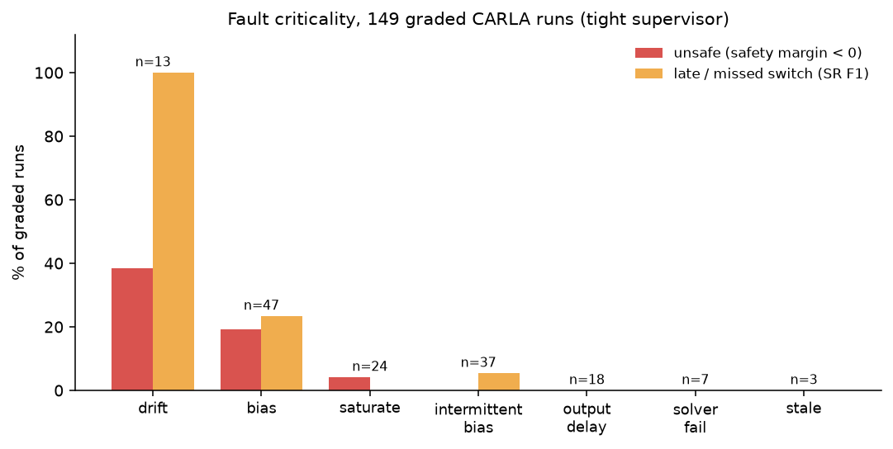
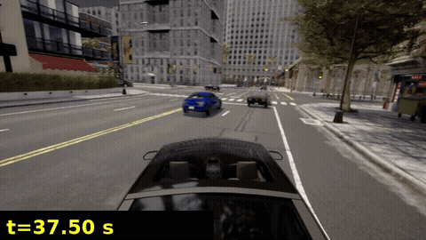
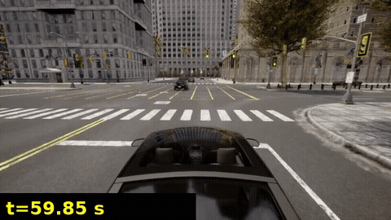
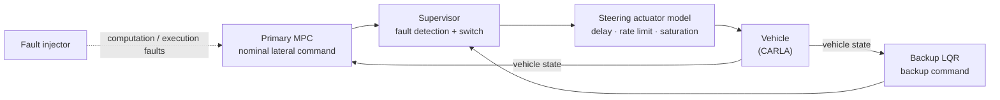
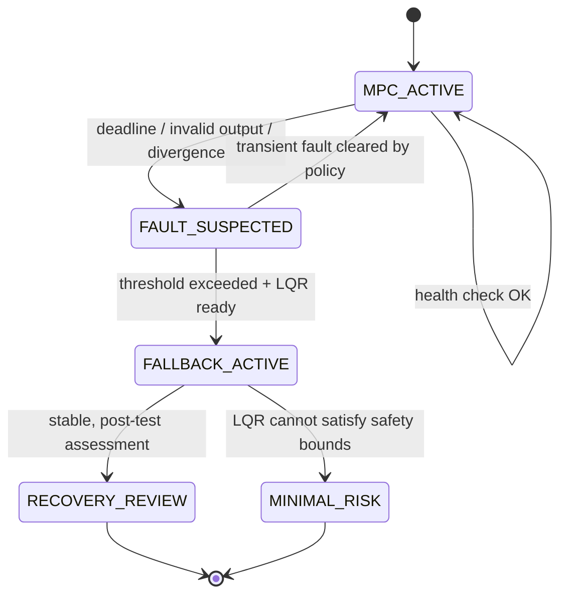

# AI-Driven Fault Injection for Safety Validation of MPC-to-LQR Controller Switching

> **A system that injects computation and execution faults into an MPC lateral controller and automatically searches
> for, and verifies, the conditions under which the switch to a backup LQR becomes unsafe, depending on when the
> switch happens and on the vehicle's dynamic state.**
>
> Submission to the NVIDIA × Nebius Hackathon, **Physical AI track**.
>
> **Status (final submission):** implementation and CARLA experiments complete. Final campaign `result/result_12`
> (32 runs; the boundary analysis also includes 119 earlier runs, 149 graded runs in total).
> These are simulation results, not a safety certification.
>
> **Judges: [JUDGES_GUIDE.md](JUDGES_GUIDE.md)**: see the results in 2 minutes, a 1-minute run without CARLA, the full
> run, and the headline findings (critical faults: 1. drift, 2. bias; their boundary values and how well the GP found the boundary).

[Architecture](docs/ARCHITECTURE.md) · [Research & Evaluation](docs/RESEARCH.md) · [Roadmap](docs/ROADMAP.md) · [Sources](docs/REFERENCES.md) · [Stage configs](pipeline/README.md)

<p align="center">
  
</p>

**In one line:** NVIDIA **Nemotron** proposes steering-controller faults, **CARLA** drives them, a **deterministic
monitor** grades every run, a **Gaussian process** steers the next runs towards the safe/unsafe boundary, and
**Cosmos Reason** explains the videos and summarises *which faults are critical and where their boundaries are*.
**Safety verdicts are always made by code, never by an LLM.**

---

## Headline results

Sources: [`result/result_12/report.md`](result/result_12/report.md),
[`result/result_12/evaluation_metrics.json`](result/result_12/evaluation_metrics.json),
[`result/result_12/insights/boundaries.json`](result/result_12/insights/boundaries.json) /
[`boundaries.md`](result/result_12/insights/boundaries.md). Supervisor profile: `tight`.

### Final campaign (`result/result_12`, CARLA + Nebius Token Factory)

| Metric | Value |
|---|---|
| CARLA fault runs | **32** (30 valid, 2 simulation-invalid) |
| Runs where the supervisor switched to the LQR | **22 / 30** valid runs |
| Final safe recovery | **14** runs (8 failures) |
| Collisions | **0** of the 30 valid runs (monitor collision flag) |
| Recovery outcomes | safe_recovery 19 · no_switch 8 · recovered_after_departure 2 · unsettled 1 · simulation_invalid 2 |
| Switch triggers | steer_rate_exceeded 14 · tracking_divergence 9 · stale_sequence 1 · none 8 |
| SR checks | pass 23 · F1 (no / late switch) 7 · invalid 2 |
| Runs to first failure / unique failure conditions | 4 / 4 |
| Runs near the boundary (\|safety margin\| < 0.2) | 11 of 30 (unsafe, margin < 0: 8) |
| **GP boundary sign accuracy** (leave-one-out, n = 22) | **0.73** (majority baseline 0.64, balanced accuracy 0.76) |
| Cosmos video explanations | 14, 11 accepted by verification (hallucination rate 0.21) |
| Candidate sources of executed runs | space filling 11 · Nemotron A 11 · perturbation 7 · counterfactual 3 |

### Critical faults and boundary values (149 graded runs: this campaign 30 + earlier 119)

<p align="center"></p>

| Rank | Fault (injected into the MPC output) | Runs | Unsafe | Late / missed switch | Worst margin | Boundary (unsafe = safety margin < 0) |
|---|---|---|---|---|---|---|
| 1 | Ramp bias / **drift** | 13 | 5 (38 %) | 13 (100 %) | −0.955 | rate 0.018–0.05 rad/s; at ≥ 35 km/h from 0.018–0.048, at ≤ 20 km/h only 0.049–0.05 |
| 2 | Constant steering **bias** | 47 | 9 (19 %) | 11 (23 %) | −0.616 | magnitude 0.043–0.1 rad; 0.048–0.075 at 25–30 km/h, 0.043–0.075 at ≥ 35 km/h |
| 3 | Steering **saturation** | 24 | 1 (4 %) | 0 (0 %) | −0.1 | duration 0.35–1.0 s, magnitude 0.6–1.0 of max steer; unsafe only when the handover happens while entering a curve |
| – | Intermittent bias | 37 | 0 | 2 (5 %) | 0.0 | no unsafe run in the tested range (0.05–0.15 rad) |
| – | Output delay / solver failure / stale output | 18 / 7 / 3 | 0 | 0 | 0.333 / 0.275 / 0.1 | no unsafe run in the tested range |

* **Slowly growing faults (drift, bias) are the weak spot.** The supervisor only sees them through the tracking
  error, so the switch comes late. Abrupt faults (saturation, intermittent bias) are caught on the first 50 ms
  sample by the steering-rate check.
* **The GP-guided search worked.** GP sign accuracy was 0.73 vs 0.64 for always guessing the majority (balanced 0.76).
  Runs near the boundary (|safety margin| < 0.2) went from 0/8 in the random cold start to 2–3 of 6 per GP round.
* A Cosmos counterfactual (raise the intermittent-bias magnitude) was re-run automatically and gave the same margin.
  For faults that are caught at once, *where* the handover happens (curve entry, speed) decides the outcome, not the fault size.

### Videos (CARLA front camera)

GitHub does not play repository MP4 files inline, so the GIFs below are short previews; click one to open the MP4.

| Worst bias run (`result_11/R00-0002-bias`) | Drift run (`result_11/R00-0003-drift`) |
|---|---|
| [](result/result_11/clips/R00-0002-bias/clip.mp4) | [](result/result_11/clips/R00-0003-drift/clip.mp4) |
| Bias 0.0753 rad at curve exit, 35 km/h, friction 0.8. Switch by tracking divergence 1.05 s after onset, **after the car had left the lane** (recovered_after_departure, SR F1). Worst bias margin −0.616. | Drift 0.0316 rad/s at the curve apex, 10 km/h, friction 0.7. Detected only after 7.35 s (tracking divergence; SR F1 late switch), then recovered safely. |

More: the Cosmos replay clips in [`result/result_11/insights/clips/`](result/result_11/insights/clips/) and
[`result/result_10/clips/`](result/result_10/clips/). For the final campaign, frame contact sheets are in
[`result/result_12/clips/`](result/result_12/clips/) (e.g. the worst drift run
[`R00-0003-drift`](result/result_12/clips/R00-0003-drift/contact_sheet.jpg), margin −0.955), and the full dashboard is
[`result/result_12/screen/campaign.html`](result/result_12/screen/campaign.html) (open it locally in a browser).

---

## 1. Project overview

When the vehicle's primary lateral controller, an **MPC**, suffers a fault such as a computation deadline overrun, a
stopped execution or a wrong output, the supervisor detects it and hands control to a backup **LQR**. Whether this
handover is safe depends strongly on **when, and in which vehicle state**, it happens:

- the MPC computation is delayed just as the car enters a curve;
- the switch happens at a moment of **high yaw rate and steering angle**, so the two controllers' outputs differ a lot;
- detection delay and high speed combine into a **long control gap**.

There are too many combinations of fault × switch time × vehicle state to cover by hand or by random sampling. In this
project, an agent based on NVIDIA **Nemotron** analyses earlier test results and proposes the next fault scenarios,
SIL simulations run on **Nebius**, and the loop searches for safety-violation conditions. **Safety verdicts are made by
deterministic code, not by the LLM.**

**Research question**

> With the same simulation budget, can an AI-driven fault injection framework find safety-critical MPC → LQR switching
> failures more efficiently than random or grid search?

## 2. System under test and scope

### System under test: MPC → LQR controller switching



Faults are injected **into the MPC only**. The steering actuator model is not a fault target; it is part of the vehicle
dynamics and makes the vehicle state at the moment of the switch realistic.

System under test: `pipeline/08_carla_paired_run/av_stack/integration/supervised_lateral.py`. The MPC steers; the
supervisor switches to the LQR on solver failure, stale or out-of-range output, steering rate > 90 °/s, or tracking
error > 0.6 m / 0.35 rad held for 0.15 s ("tight"). The original "legacy" thresholds were 1.0 m / 0.6 rad / 0.25 s
with no rate check, and every switch on a slowly growing fault came after the car had left the lane.

> Background: in steering systems without a mechanical link between the steering wheel and the wheels, such as
> steer-by-wire (SbW), a driver cannot hold the wheel against a faulty controller, so the safety of controller switching matters even more.

### Scope

| | |
|---|---|
| **In scope** | MPC computation and execution faults, supervisor switching, LQR backup control, searching for safety violations as a function of switch time and vehicle state |
| **Out of scope** | Hardware faults (sensors, actuators, communication), verification of redundant SbW motors / ECUs, hardware safety certification |

> MPC → LQR is an **example controller pair for research and testing**, not a standard production combination. An
> algorithmic backup does not address physical faults of sensors, power, motors or ECUs, and it does not imply hardware redundancy.

## 3. System architecture

The figure at the top shows the loop as implemented in `run.py` (stages 00–10). Stage configs are listed in
[pipeline/README.md](pipeline/README.md), interfaces in [docs/ARCHITECTURE.md](docs/ARCHITECTURE.md).

| Stage | What it does | Code / config |
|---|---|---|
| 00–02 | Prior knowledge, code-verified safety profile of the system under test, hypotheses and the search objective | `pipeline/00..02_*`, `run.py stage_00_02` |
| 03 | **Nemotron A** (Nemotron 3.5 Lightning) proposes fault scenarios (route, speed, tyre friction, fault type and size, onset) aimed at the boundary, given the GP summary and past outcomes | `engine/nemotron.py`, `pipeline/03_nemotron_a` |
| 04 | Feasibility gate (scenario space, route events, evaluation window) + space-filling, perturbed and counterfactual candidates | `engine/scenarios.py`, `pipeline/04_feasibility_expansion/` |
| 05a / 05b | Deterministic features; **Nemotron B** (Nemotron 3 Ultra) answers code questions about the controller (cited lines, checked against a code answer key) | `pipeline/05a_*`, `pipeline/05b_nemotron_b` |
| 06 | GP surrogate: safety margin (regression) and switch probability (classifier) | `engine/surrogate.py`, `pipeline/06_gp_surrogate` |
| 07 | Batch selection: level-set acquisition near the boundary, Nemotron share, diversity, control-fault cap | `run.py stage_07`, `pipeline/07_orchestrator` |
| 08 | CARLA paired runs: fault-free baseline (cached) and fault run on Bench2Drive routes with the PDM-Lite planner and our MPC / supervisor / LQR | `engine/carla_runner.py`, `pipeline/08_carla_paired_run/av_stack` |
| 09 | **Deterministic monitor**: recovery verdict, safety margin (lane / settle / lateral acceleration / jerk), SR1–SR6 safety requirements, F1/F2/F3/pass | `engine/monitor.py`, `engine/sr_checks.py`, `pipeline/09_monitor/` |
| 10 | **Cosmos Reason** explains each failed run's front video using the monitor's events as facts; verified explanations feed back (examples for Nemotron A, counterfactual re-runs). After the campaign: critical faults and boundary values | `engine/explainer.py`, `engine/boundaries.py`, `pipeline/10_video_explainer` |

Role separation: only Nemotron A sees past failures · Nemotron B sees only code · the explainer sees only the video and
context (fault and switch times), not the departure / collision / offset values · only the 09 monitor grades runs.
Explanations never change a verdict.

### NVIDIA models and Nebius usage

| NVIDIA model (via Nebius) | Role in the pipeline | Code |
|---|---|---|
| **Nemotron 3.5 Lightning** (`nvidia/Nemotron-3_5-Lightning`) | Nemotron A: proposes fault scenarios aimed at the safe/unsafe boundary from the GP summary, past outcomes and route geometry; refines candidates near the boundary | `engine/nemotron.py`, stage 03 |
| **Nemotron 3 Ultra 550B** (`nvidia/Nemotron-3-Ultra-550b-a55b`) | Nemotron B: reads the controller source code and answers fixed questions per scenario (3 votes); answers become GP features and are checked against a code answer key | stage 05b |
| **Cosmos 3 Super Reasoner** (NVIDIA Cosmos Reason) | Explains each failed run's front-camera video with the monitor's events as facts; after the campaign, reads the boundary table and states the critical faults and boundary values | `engine/explainer.py`, `engine/boundaries.py` |
| **Nemotron 3.5 Super VL** (`nvidia/Nemotron-3.5-Super-VL`) | Fallback video / vision model when the Cosmos endpoint is not up | stage 10 |

Where **Nebius Token Factory** accelerated the work, and the other Nebius services used:

* **One OpenAI-compatible API and key for every model**: models are switched per role in `pipeline/llm_models.yaml`
  (fast Lightning for many proposals, the 550B Ultra for code reasoning) with no local GPU and no serving code.
* **Structured outputs** (`response_format` = `json_schema`, `engine/llm.py`): Nemotron A's scenarios always parse
  and validate against the scenario space, so overnight campaigns (84 CARLA runs in result_8) ran without manual cleanup.
* **A 550B model on demand**: Nemotron 3 Ultra answers three votes per scenario during a campaign; hosting it
  ourselves was not possible on our hardware.
* **Dedicated endpoint for Cosmos Reason**, started and stopped by our code through the control API
  (`GET/PATCH /v0/dedicated_endpoints`, `engine/cosmos_power.py`): billed only while the video step runs, and stopped
  on errors and at exit.
* Not used: Nebius AI Cloud compute (CARLA ran on a local Windows PC with an NVIDIA GPU).
* Every model call of a campaign is logged in `llm_calls.jsonl` (model, tokens; never keys).

Model ids are set in [`pipeline/llm_models.yaml`](pipeline/llm_models.yaml); check the ids available to your account with `GET /v1/models`.

## 4. Controller switching logic



Risks checked during the switch:

- **Switching transient:** the steering angle jumps because the two controllers' outputs differ (bumpless-transfer failure).
- **Detection delay:** the control gap until the MPC fault is noticed.
- **Leaving the operating region:** the LQR works well only near its linearisation point, so it can degrade at high speed or large steering angles.

> This state diagram is the **proposed logic under test**. `MINIMAL_RISK` is a target state, not a proven safe one.
> Switching back to the MPC (re-entry) is out of scope.

## 5. Faults and variables

| Type | Fault injection example | What it tests |
|---|---|---|
| Deadline overrun | MPC update misses its deadline | detection / switch delay |
| Execution stop | MPC computation / output stops (solver failure) | LQR activation and tracking error |
| Wrong output | steering command bias / drift / saturation / intermittent bias | output validity checks, steering jumps |
| Delayed output | previous steering command held (stale, output delay) | stale-command handling |

**Scenario variables (inputs):** fault type, onset, magnitude and duration; route and onset event (straight, curve
entry / apex / exit); initial speed; tyre friction.

**Vehicle state at the switch (recorded and analysed):** yaw rate, lateral acceleration, steering angle and rate,
lateral and heading error, and the **MPC − LQR output difference** at the moment the LQR takes over.

## 6. Metrics

Numbers are computed from the run logs so that no LLM "guesses" safety. Definitions are in [docs/RESEARCH.md](docs/RESEARCH.md);
thresholds are in [`pipeline/09_monitor/safety_spec.yaml`](pipeline/09_monitor/safety_spec.yaml).

| Metric | Definition |
|---|---|
| **Safety margin** (GP target) | combines the lane margin (vehicle footprint vs lane boundary), settling, lateral acceleration and lateral jerk terms; < 0 = unsafe |
| **Lane boundary violation** | whether the vehicle footprint crossed the lane boundary |
| **Detection / handover latency** | time from fault onset to detection and LQR handover (s) |
| **Recovery** | back within 0.3 m / 0.1 rad and held for 1 s inside a 3 s window |
| **SR1–SR6** | safety requirements (F1 no / late switch, F2, F3, pass) |
| **GP boundary sign accuracy** | leave-one-out accuracy of the GP's safe/unsafe sign |
| **Runs to first failure, unique failure conditions** | search efficiency |

Thresholds marked PROVISIONAL (0.3 m, 0.1 rad, 1.0 s hold, 3.0 s window, 4.41 m/s², 15.0 m/s³) are our choices for
this study, not certified limits.

## 7. Comparison design

Same vehicle, fault parameter space, seeds and simulation budget:

1. **Random search** (`--ablation X-1`): random selection within the ranges
2. **Grid / stratified search**: a fixed grid or stratified sample
3. **LLM one-shot** (optional): Nemotron generation without feedback
4. **Feedback-guided Nemotron + GP** (default, X-5 / X-6 with video explanations)

The final campaign started from a random cold start (8 runs) followed by 4 GP-guided rounds of 6; see the headline results above.

## 8. Repository layout

```text
├── README.md · JUDGES_GUIDE.md
├── run.py                         # one entry point: python run.py --mock | --real | --check
├── engine/                        # all executable code (pipeline/ holds stage configs only)
│   ├── judgment.py · monitor.py   # pure grading functions · stage-09 monitor (CLI: python -m engine.monitor RUN_DIR --baseline DIR)
│   ├── sr_checks.py · dashboard.py# SR1–SR6 checks · campaign screen (outputs/<run>/screen/campaign.html)
│   ├── boundaries.py · insights.py# critical faults + boundary values · campaign insights
│   ├── surrogate.py · scenarios.py · nemotron.py · llm.py · carla_runner.py · video.py · explainer.py · feedback.py
│   ├── fixtures/                  # mock-only synthetic simulator and scenario space (SYNTHETIC)
│   ├── hypothesis_tools/ · prior_tools/
├── pipeline/                      # stage configs 00..10 (see pipeline/README.md), llm_models.yaml, evaluation/ (ablations X-1..6)
├── result/result_1..12/           # CARLA campaigns (final: result_12)
├── docs/                          # architecture, research, roadmap, references, bug reports, integration notes, images
├── tests/                         # python -m pytest -q
├── configs/scenario.example.yaml  # scenario spec example (not a run config)
├── examples/test-result.example.json
├── requirements-pipeline.txt
└── .env.example                   # API key placeholders (never commit real keys)
```

## 9. Quickstart

### Install

```bash
python -m venv .venv-sil
.venv-sil/bin/pip install -r requirements-pipeline.txt      # Windows: .venv-sil\Scripts\pip ...
```

### Mock mode (no CARLA, no network, synthetic data, about 1 minute)

```bash
python run.py --mock --cold-start 6 --rounds 1 --batch-size 3 --open-screen off --out outputs/judge_demo
python run.py --mock --ablation-suite        # compare X-1,2,3,5,6 (SYNTHETIC)
python -m pytest -q
python run.py --check                        # report null entries in the stage YAMLs (exit 2 if any remain)
python -m engine.monitor RUN_DIR --baseline BASE_DIR   # grade a single run folder
python -m engine.boundaries result/result_12 --publish-only   # re-render the final campaign's pages
```

Mock mode uses `engine/fixtures/synthetic_sim.py` (kinematic simulator, 320x180 synthetic video) and stub LLMs. Every
file carries `synthetic_fixture: true` and the report is marked SYNTHETIC. **Mock numbers are not measurements.**

### Real mode (CARLA 0.9.15 + Nebius Token Factory)

```powershell
# 1) CARLA server
powershell -ExecutionPolicy Bypass -File .\pipeline\08_carla_paired_run\av_stack\start_carla_stable.ps1
# 2) key: NEBIUS_API_KEY=... in .env (never commit it)
# 3) preflight, then run
.\pipeline\08_carla_paired_run\av_stack\.venv-tfpp\Scripts\python.exe run.py --real --check
.\pipeline\08_carla_paired_run\av_stack\.venv-tfpp\Scripts\python.exe run.py --real --cold-start 8 --rounds 4 --batch-size 6 --out results/my_campaign
```

See [JUDGES_GUIDE.md](JUDGES_GUIDE.md) §3 for the exact final-campaign command (with `--gp-history`).

| Environment variable | Meaning |
|---|---|
| `NEBIUS_API_KEY` | Token Factory key (required; never printed or logged) |
| `NEMOTRON_A_MODEL_ID`, `NEMOTRON_B_MODEL_ID` | override model ids (defaults in `pipeline/llm_models.yaml`) |
| `COSMOS_MODEL_ID`, `COSMOS_BASE_URL`, `COSMOS_API_KEY` | Cosmos Reason dedicated endpoint; falls back to `nvidia/Nemotron-3.5-Super-VL` if missing |
| `AV_STACK_ROOT` / `SIM_EVAL_ROOT` | av_stack location if not in the default place |
| `AV_STACK_PYTHON` | a python that can import carla (default `av_stack\.venv-tfpp\Scripts\python.exe`) |
| `CARLA_HOST`, `CARLA_PORT` | default localhost:2000 |
| `FFMPEG` | ffmpeg path (otherwise PATH, then imageio-ffmpeg) |

Windows notes: paths with spaces are fine (subprocess list arguments); no ffmpeg globbing; one CARLA instance
(`parallel_workers: 1`); each run's `--out` must be a new folder.

### Outputs (`outputs/<mode>_<time>/`)

`run_records.jsonl`, `failure_table.jsonl`, `explanations.jsonl`, `monitor_rule_candidates.yaml` (proposals for human
review, never applied automatically), `evaluation_metrics.json`, `llm_calls.jsonl` (token usage, no keys),
`report.md`, `insights/` (boundaries, insights, dashboard), `round_xx/`, `runs/`, `clips/`, `screen/campaign.html`.

## 10. Limitations

* Only MPC computation and execution faults; sensor / actuator hardware faults are out of scope.
* This is a simulation-based research tool, not production vehicle software or an ISO 26262 tool. Results from one
  simulator and vehicle model do not generalise to a real-vehicle safety guarantee.
* If the MPC and LQR share a sensor or ECU, an algorithmic backup cannot prevent hardware faults.
* Boundaries come from 149 runs over several routes and speeds; most are "mixed zones" whose exact value depends on
  road geometry and speed. Two of the most critical (very late) drift / bias runs were graded *invalid* because the
  route or the 15 s run limit ended before the post-switch window.
* **Not finding a failure does not prove safety.**

Bug reports and design notes: [docs/BUG_REPORTS.md](docs/BUG_REPORTS.md), [docs/INTEGRATION3.md](docs/INTEGRATION3.md), [docs/INTEGRATION4.md](docs/INTEGRATION4.md).

## License

[MIT](LICENSE) for this repository's code. Third-party components (CARLA, CARLA Garage / PDM-Lite, Bench2Drive, ...)
keep their own licenses, listed in
[`pipeline/08_carla_paired_run/av_stack/THIRD_PARTY_NOTICES.md`](pipeline/08_carla_paired_run/av_stack/THIRD_PARTY_NOTICES.md).
NVIDIA models are used through Nebius Token Factory under their own terms.
