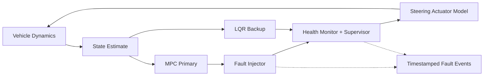

# Architecture & Interfaces (제안)

## 계층 구분

1. **Intelligence plane:** Nemotron 모델을 사용해 테스트 후보를 추천한다. LLM 출력은 신뢰할 수 없는 제안으로 취급한다.
2. **Control plane:** 시나리오 스키마 검증, 실험 ID, queue, 워커 할당, 재시도, 상태 추적, 비용 예산 처리.
3. **Simulation plane:** SIL 우선, CARLA 추후 도입. `world state → MPC (or LQR) → steering command → actuator/plant → state` 구조.
4. **Evaluation plane:** 로그로부터 기준 위반 판정 및 시각화. 동일 로그·동일 기준이면 동일 결과가 나와야 한다.

## Fault injection 위치



Fault injector는 제어기 실행 중단, 출력값 왜곡, output stale, 계산 deadline miss를 모델링한다. `Supervisor`는 정해진 fault-detection policy에 따라 실제 applied command source를 전환한다. **오류를 감지하는 조건이 테스트에서 변경되면 전환 지연과 실패 라벨도 함께 기록**한다.

## 최소 데이터 계약

`Scenario`: `scenario_id`, `seed`, `initial_speed_mps`, `road_curvature_inv_m`, `fault.type`, `fault.start_s`, `fault.duration_s`, `fault.magnitude`, `detection_delay_s`, `controller_config_hash`, `simulator_version`.

`StepLog`: `time_s`, `x_m`, `y_m`, `yaw_rad`, `speed_mps`, `reference_path`, `lateral_error_m`, `primary_command_rad`, `backup_command_rad`, `applied_steering_rad`, `active_controller`, `fault_active`, `fault_detected`, `switch_event`.

`Evaluation`: `scenario_id`, `run_id`, `failure_labels`, `max_lateral_error_m`, `lane_boundary_violation`, `max_steering_jump_rad`, `detection_latency_s`, `handover_latency_s`, `recovery_time_s`, `seed`, `git_commit`, `criteria_version`.

## 권장 프로세스 격리

- 실제 시스템과 달리 초기 MVP에서는 두 제어기를 동일 프로세스에서 실행해도 된다. 이 경우 **process crash / ECU power loss에 대한 독립 복구를 검증할 수 없다**.
- 물리적/계산적 격리를 테스트하려면 분리 프로세스·ECU·전원·통신 모델을 명시적으로 추가해야 한다.
- Timeout 판정은 simulation time vs wall clock time을 구분한다. 고정 시뮬레이션 주기에서 인위적인 latency fault를 모델링하는 경우 hardware deadline guarantee라고 주장하면 안 된다.
- CARLA를 사용할 때 synchronous mode, fixed delta, seed, map/weather/vehicle versions을 기록하고 각 CARLA world는 단일 tick owner를 둔다.

## 클라우드 적용

- **Token Factory:** `GET /v1/models`로 계정에서 사용 가능한 Nemotron 모델을 확인한 뒤 API를 호출한다. 인증키는 환경 변수/secret manager로만 제공한다.
- **Nebius AI Cloud:** 설치된 이미지와 리소스가 실험에 적합한지 확인 후 worker 컨테이너를 실행한다. 특정 서비스의 GPU 수·시간·지원 기능을 미리 보장하지 않는다.
- **선택적 AWS:** 과거 플랫폼 구상과 호환되도록 S3/object storage, SQS/queue, DB/metadata store로 대체 가능하다. 초기 구현의 필수 의존성은 아니다.
- **Reproducibility:** scenario hash, run ID, random seed, container digest, controller commit, result checksum 기록; job retries는 idempotent writes 사용.

## 예시 API (확정 인터페이스 아님)

```text
POST /experiments        # budget, baselines, safety criteria
POST /scenarios/validate # schema + range checks
POST /runs                # validated scenario, controller builds
GET  /runs/{id}          # logs, events, metrics, replay
GET  /experiments/{id}   # cumulative failure discovery summary
```

실제 배포 전 OpenAPI 스키마, 인증, resource quotas, input sandboxing을 설계해야 한다.
