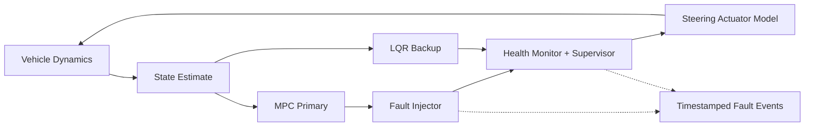

# Architecture & Interfaces (proposal)

## Layers

1. **Intelligence plane:** Nemotron models recommend test candidates. LLM output is treated as an untrusted proposal.
2. **Control plane:** scenario schema validation, experiment IDs, queue, worker assignment, retries, state tracking, cost budget.
3. **Simulation plane:** SIL first, CARLA later. Structure: `world state → MPC (or LQR) → steering command → steering actuator model → plant → state`. The steering actuator is a simple model with response delay (first-order lag), steering-rate limit and steering-angle saturation; it is part of the plant, not a fault-injection target.
4. **Evaluation plane:** violation verdicts and visualisation from the logs. The same logs and the same criteria must give the same result.

## Where faults are injected



The fault injector models stopped controller execution, distorted output, stale output and missed computation deadlines. Faults are injected **into the MPC only**; sensor and actuator faults are out of scope. The supervisor records the vehicle state at the moment the LQR takes over (`state_at_switch`). The `Supervisor` switches the actually applied command source according to a fixed fault-detection policy. **If a test changes the detection conditions, the switch delay and failure labels are recorded with it.**

## Minimal data contract

`Scenario`: `scenario_id`, `seed`, `initial_speed_mps`, `road_curvature_inv_m`, `fault.type`, `fault.start_s`, `fault.duration_s`, `fault.magnitude`, `detection_delay_s`, `actuator.time_constant_s`, `actuator.rate_limit_rad_s`, `actuator.max_angle_rad`, `supervisor.detection_threshold`, `supervisor.debounce_s`, `controller_config_hash`, `simulator_version`.

`StepLog`: `time_s`, `x_m`, `y_m`, `yaw_rad`, `speed_mps`, `reference_path`, `lateral_error_m`, `primary_command_rad`, `backup_command_rad`, `applied_steering_rad`, `active_controller`, `fault_active`, `fault_detected`, `switch_event`.

`Evaluation`: `scenario_id`, `run_id`, `failure_labels`, `max_lateral_error_m`, `lane_boundary_violation`, `max_steering_jump_rad`, `detection_latency_s`, `state_at_switch` {`yaw_rate_rad_s`, `lat_accel_mps2`, `sideslip_rad`, `steering_rad`, `steering_rate_rad_s`, `lateral_error_m`, `heading_error_rad`, `mpc_lqr_command_gap_rad`}, `handover_latency_s`, `recovery_time_s`, `seed`, `git_commit`, `criteria_version`.

## Recommended process isolation

- Unlike a real system, the initial MVP may run both controllers in the same process. In that case **independent recovery from a process crash / ECU power loss cannot be verified**.
- Testing physical / computational isolation requires explicitly adding separate processes, ECUs, power and communication models.
- Timeout verdicts distinguish simulation time from wall-clock time. An artificial latency fault modelled on a fixed simulation step must not be claimed as a hardware deadline guarantee.
- With CARLA, record synchronous mode, fixed delta, seed and map / weather / vehicle versions, and give each CARLA world a single tick owner.

## Cloud usage

- **Token Factory:** list the Nemotron models available to the account with `GET /v1/models` before calling the API. Keys are provided only through environment variables / a secret manager.
- **Nebius AI Cloud:** check that the installed image and resources fit the experiment before starting worker containers. GPU counts, time and features of a given service are not guaranteed in advance.
- **Optional AWS:** for compatibility with an earlier platform design, S3 / object storage, SQS / queue and a DB / metadata store can be substituted. Not a required dependency of the initial implementation.
- **Reproducibility:** record scenario hash, run ID, random seed, container digest, controller commit and result checksum; job retries use idempotent writes.

## Example API (not a final interface)

```text
POST /experiments        # budget, baselines, safety criteria
POST /scenarios/validate # schema + range checks
POST /runs                # validated scenario, controller builds
GET  /runs/{id}          # logs, events, metrics, replay
GET  /experiments/{id}   # cumulative failure discovery summary
```

Before a real deployment, an OpenAPI schema, authentication, resource quotas and input sandboxing must be designed.
