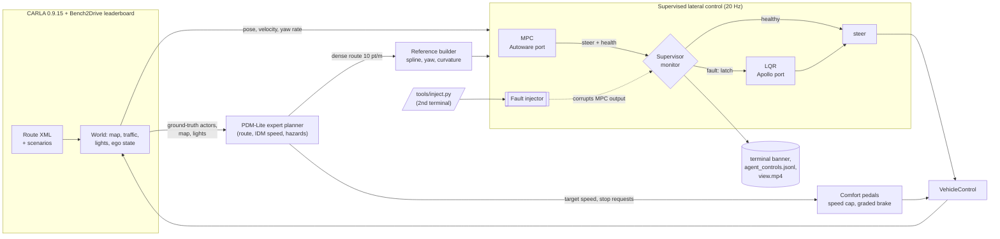

# av_stack — MPC → LQR safety switching on CARLA

A software-in-the-loop (SIL) testbed for one question:

> **When the primary steering controller (MPC) fails, does a supervisor detect it and hand
> steering to a fallback controller (LQR) quickly and safely enough?**

The car drives published CARLA routes. A planner decides *where* and *how fast* to go; our
MPC steers; a supervisor watches the MPC every 50 ms and, on a detected fault, latches
steering to an independent LQR. Faults are injected **live from a second terminal** while
the car is driving, and the terminal prints what the supervisor detected and when.

<p align="center"><code>STEERING: MPC</code> → fault injected → <code>[SUPERVISOR] fault detected → MPC → LQR</code> → <code>STEERING: LQR (fallback)</code></p>

---

## Architecture



| Layer | What it does | Code |
|---|---|---|
| **Planner** | [PDM-Lite](https://github.com/autonomousvision/carla_garage) (DriveLM, ECCV 2024): rule-based expert that generated the CARLA Garage / TransFuser++ training data. Route following, IDM car following, traffic lights, stop signs, pedestrians, scenario obstacles. Used unchanged except its steering PID, which is replaced by ours. | `integration/pdm_agent.py` |
| **Primary controller** | Linear time-varying MPC, port of Autoware `mpc_lateral_controller` (dynamic bicycle error model, N = 50 × 0.1 s, steering / rate constraints, own ADMM QP solver). | `mpc_controller/` |
| **Fallback controller** | LQR, port of Apollo `lat_based_lqr_controller` (iterative Riccati, curvature feed-forward), plus 0.2 s curvature preview. | `lqr_controller/` |
| **Supervisor** | Checks every MPC sample; on the first bad one switches to LQR in the same 50 ms cycle and latches. | `integration/supervised_lateral.py` |
| **Fault injector** | Corrupts the MPC output only (never the LQR, never the supervisor's inputs). | `integration/fault_injection.py` |
| **Demo layer** | Live injection, terminal banners, chase-camera window, comfort pedals, green lights. | `integration/live_control.py`, `integration/chase_view.py` |

`planner/`, `mpc_controller/` and `lqr_controller/` never import each other or CARLA
(`tests/test_separation.py` enforces it); `integration/` is the only place they are wired together.

### Inputs and outputs

| | |
|---|---|
| **Route** | Bench2Drive / CARLA leaderboard 2.0 route XML: sparse waypoints + scenario triggers (`--routes`, `--route-id`). |
| **World state (planner)** | Simulator ground truth through PDM-Lite: HD map, other vehicles, pedestrians, traffic-light states. Perception is out of scope. |
| **Vehicle state (controllers)** | Pose (x, y, yaw), body velocity (vx, vy), yaw rate — converted from CARLA's left-handed frame (`integration/carla_io.py`). Vehicle parameters (mass, axle distances, steering limit) are read from CARLA's physics control. |
| **Faults** | `tools/inject.py <mode> [magnitude]` while driving, or `--mpc-fault` at a fixed time. |
| **Control output** | `carla.VehicleControl`: steering from MPC or LQR, throttle/brake from PDM-Lite through the comfort-pedal layer. |
| **Logs** | See [Outputs](#outputs). |

---

## Quick start (Windows)

Requirements: CARLA 0.9.15 (Windows build) next to this repository or `CARLA_ROOT` set to its
`WindowsNoEditor` folder; Python 3.10 environment `.venv-tfpp` (see [Setup](#setup)); a GPU is not needed for the PDM-Lite path.

All commands run in PowerShell from the `pipeline/08_carla_paired_run/av_stack` folder (pipeline stage 08).

**1. Start CARLA**
```powershell
powershell -ExecutionPolicy Bypass -File .\start_carla_stable.ps1
```

**2. Drive (terminal 1)** — Town10 downtown route, supervised MPC → LQR, signals green for the ego, video saved:
```powershell
& ".\.venv-tfpp\Scripts\python.exe" run_benchmark.py --routes town10_long --planner pdm --controller supervised --green-lights --record-front --out runs\demo_01
```
An **`av_stack view`** window opens with the chase camera and the steering owner in the top-left corner.

**3. Inject a fault whenever you like (terminal 2, any folder)**
```powershell
& "<repo>\av_stack\.venv-tfpp\Scripts\python.exe" "<repo>\av_stack\tools\inject.py" solver_fail
```
(in `cmd.exe` drop the leading `&`). Terminal 1 then prints, for example:
```
>>> [INJECT] t= 38.90s  MPC solver failure

============================================================================
  [SUPERVISOR] fault detected -> steering switched MPC -> LQR   (t=38.90 s)
    detected : MPC solver reported failure
    when     : 0.00 s after the fault was injected
    state    : e_y=-0.01 m, e_psi=+0.2 deg, v=31.2 km/h
============================================================================
```

### Faults you can inject

| Command | Kind | What happens to the MPC output | Expected supervisor reaction |
|---|---|---|---|
| `solver_fail` | availability | `ok=False`, no steering | immediate (`solver_failure`) |
| `nan` | availability | steering = NaN | immediate (`nonfinite_output`) |
| `stale` | availability | previous sample repeated | immediate (`stale_sequence`) |
| `exception` | availability | MPC raises | immediate (`controller_exception`) |
| `delay` | availability | answer arrives 75 ms late (> 50 ms period) | immediate (`deadline_miss`) |
| `bias <rad>` | **integrity** | healthy-looking output + constant offset | only via path divergence, late or never |
| `drift <rad/s>` | **integrity** | healthy-looking output + growing offset | only via path divergence, late |
| `clear` | — | stop injecting (an LQR takeover stays latched) | — |

### Supervisor checks (per 50 ms sample)

| Check | Trigger |
|---|---|
| Solver status | `ok == False` or no steering command |
| Finite output | NaN / inf in steering, state or timestamps |
| Actuator range | \|steer\| > vehicle steering limit |
| Deadline | computation > 50 ms |
| Freshness | timestamp older than 0.1 s, or sequence number not increasing |
| Exception | MPC raised |
| Tracking divergence | \|e_y\| > 1.0 m or \|e_ψ\| > 0.6 rad for 0.25 s |

After a switch: steering is latched to LQR for the rest of the run, LQR steering rate is
limited to 90 °/s (SR2 bound), and an invalid LQR output commands a full-brake safe stop.

---

## Results so far

**Town10 downtown, 343 m** (`town10_long`, MPC fault injected mid-route, supervised):
Bench2Drive score **100**, route 100 %, 0 collisions, 0 lane departures; takeover in the same
50 ms cycle; max path error after takeover 0.16–0.20 m.

**Attack sweep, route 26956** (signalized right turn, fault 1 s before the turn, supervised):

| Fault | Outcome | Detection delay | Max path error |
|---|---|---|---|
| solver_fail / nan / stale / exception / delay | switched, safe | 0.0 s | 0.63 m |
| bias 0.02 rad | **not detected** (stayed safe) | — | 0.71 m |
| bias 0.05 rad | switched, **unsafe** | 4.7 s | **1.13 m** |
| bias 0.10 rad | switched, **unsafe** | 2.3 s | **1.57 m** |
| drift 0.05 rad/s | switched, **unsafe** | 2.6 s | **1.46 m** |

Availability faults are caught instantly. **Integrity attacks are the supervisor's blind spot**:
the only check that can see them is path divergence (1 m for 0.25 s), so the car is already past
the 0.8 m lateral-error safety requirement (SR4) when — or if — the switch happens. Finding such
cases automatically is the goal of the AI scenario-generation pipeline in [`../pipeline`](../pipeline).

---

## Command reference

`run_benchmark.py` (run with `.venv-tfpp`):

| Option | Default | Meaning |
|---|---|---|
| `--routes` | `bench2drive` | `town10_long` (Town10, 343 m), `town04_highway` (2.2 km, no signals), `bench2drive` (220 short routes) or a route XML path |
| `--route-id` | only route | Route id inside the file (`--list` prints Bench2Drive ids) |
| `--planner` | `transfuserpp` | **`pdm`** for the demo; `transfuserpp` / `tcp` are learned planners (experimental) |
| `--controller` | `mpc` | `supervised` (MPC + supervisor + LQR), `mpc_unprotected` (no supervisor, for comparison), `mpc`, `lqr` |
| `--green-lights` | off | The light ahead of the ego turns green (its junction's other directions red) |
| `--max-speed` | 40 | Speed cap [km/h] |
| `--no-comfort` | off | Use PDM-Lite's original bang-bang pedals |
| `--no-view` | off | Do not open the chase-camera window |
| `--record-front` | off | Save `view.mp4` (chase view with label) and `front.mp4` |
| `--monitor S` | 0 | Also print a status line every S seconds |
| `--mpc-fault`, `--fault-start`, `--fault-duration`, `--fault-magnitude` | none | Scheduled fault instead of live injection |
| `--stop-after-fault S` | — | End the run S seconds after the fault starts |
| `--out` | — | Output folder (must be new) |

## Outputs

Each run folder (`runs/<name>/`):

| File | Content |
|---|---|
| `results.json`, `evaluation_events.json` | Official Bench2Drive scoring: route completion, collisions, lane departures, red lights, min speed |
| `agent_controls.jsonl` | One line per 50 ms: time, steer/throttle/brake, speed, steering owner, lateral & heading error, MPC status and computation time, supervisor reason / switch time, fault mode, PDM-Lite's raw pedals and hazard flags |
| `view.mp4` | Chase camera with the steering label (with `--record-front`) |
| `front.mp4`, `front_frames.jsonl` | Roof camera and frame timing |
| `manifest.json`, `agent_config.json` | Route, map, controller, fault and vehicle parameters used |

---

## Setup

```powershell
# third-party code at pinned commits (CARLA Garage + Bench2Drive; add -WithTCP / -WithModels for learned planners)
powershell -ExecutionPolicy Bypass -File .\tools\fetch_third_party.ps1
# Python 3.10 environment
uv venv .venv-tfpp --python 3.10
uv pip install --python .\.venv-tfpp\Scripts\python.exe -r requirements-tfpp-lock.txt
```
Controller-only work (offline simulation, unit tests) runs in any Python ≥ 3.8 with `numpy`, `scipy`:
```powershell
python tests\run_all.py          # planner / MPC / LQR / fake-CARLA tests
python run_offline.py --controller mpc --plot
```

## Repository layout

```
pipeline/08_carla_paired_run/av_stack/
├─ planner/            reference trajectory (cubic spline, speed profile, lane change)
├─ mpc_controller/     Autoware MPC port + ADMM QP solver
├─ lqr_controller/     Apollo LQR port
├─ integration/        everything CARLA-specific: agents, supervisor, fault injector, demo layer
├─ scenarios/          route XMLs (town10_long, town04_highway)
├─ tools/              inject.py, wait_carla.py, fetch_third_party.ps1
├─ experiments/        closed-loop sweeps behind controller tuning choices
├─ tests/              offline tests (no CARLA server needed)
├─ docs/MODULES_ko.md  detailed notes on the planner / MPC / LQR ports (Korean)
├─ run_benchmark.py    main entry point (Bench2Drive routes, PDM-Lite / TF++ / TCP)
└─ run_carla.py, run_urban.py, run_autonomy.py, run_offline.py   earlier runners
```

## Credits and licences

Autoware Universe and Apollo (Apache-2.0) algorithms re-implemented in Python; PythonRobotics
(MIT); CARLA agents (MIT); CARLA Garage / PDM-Lite / Bench2Drive (MIT, fetched at pinned commits,
local patches in `third_party/patches/`). TCP (CC BY-NC-ND 4.0) is optional and never
redistributed. Details: [THIRD_PARTY_NOTICES.md](THIRD_PARTY_NOTICES.md).
