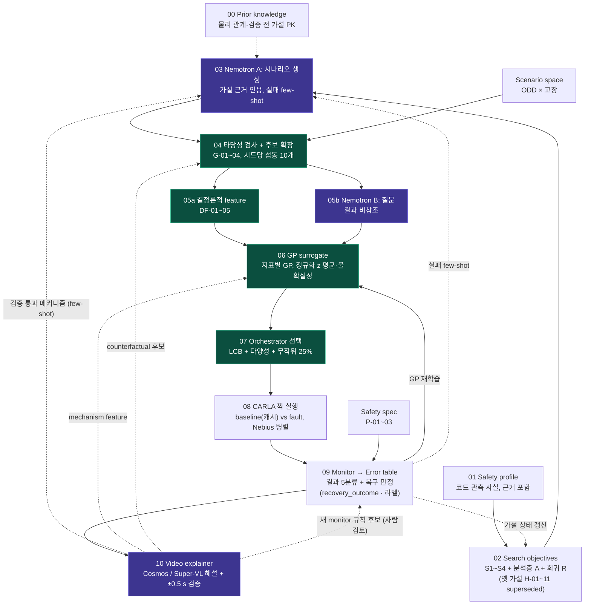

# Code-aware 고장 주입 파이프라인

> 설정 파일은 **템플릿**(`status: template_unverified`)이며 수치는 실측값이 아닙니다.
> 2026-10-27: 실행 엔진 `engine/` 과 진입점 `run.py` 추가 (`python -m pipeline.run --mock`). 사용법은 저장소 README 12절.



🟪 Nemotron · 🟩 결정론·학습 · ⬜ 파일·시뮬

## 단계별 파일

| 단계 | 파일 | 내용 |
|---|---|---|
| 00 Prior knowledge | [`00_prior_knowledge/prior_knowledge.yaml`](00_prior_knowledge/prior_knowledge.yaml) | 물리 관계 PK-001, 검증 전 가설 PK-002/003 ([`prior_tools`](prior_tools/README.md)) |
| 01 Safety profile | [`01_safety_profile/safety_profile.yaml`](01_safety_profile/safety_profile.yaml) | 코드에서 추출한 관측 사실(O-xxx)과 근거 |
| 02 Hypotheses | [`02_hypotheses/vulnerability_patterns.yaml`](02_hypotheses/vulnerability_patterns.yaml) | 취약 패턴 카탈로그 v2(틀, 11개) + 지표 규칙·GP 타깃 규칙 + 판정 절차 |
| | [`02_hypotheses/hypotheses.yaml`](02_hypotheses/hypotheses.yaml) | 패턴 × 프로필로 생성된 가설 (자동 생성). 활성 패턴이 없어 지금은 비어 있음 |
| | [`02_hypotheses/search_objectives/`](02_hypotheses/search_objectives/) | **S-세트** (새 스키마 초안, 파이프라인 미연결): S1 LQR 인계 경계: 전환 순간 오차 × 조향 포화(H-01+H-04+H-05+H-09), S2 고장 시점·감지 지연(H-02+H-06), S3 자연 MPC 열화(H-10+H-08+H-11, 고장 주입 없음), S4 선택, A 모든 런 공통 전환 기록, R 회귀 검증(H-03 등). H-07 보류. 공통 규칙 `_common.yaml` |
| | [`hypothesis_tools/`](hypothesis_tools/) | 가설 생성기 · 시나리오 후보 샘플러 · 예시 입력 |
| 03 Nemotron A | [`03_nemotron_a/nemotron_a.yaml`](03_nemotron_a/nemotron_a.yaml) | 시나리오 후보 생성 (실패 few-shot 입력) |
| 04 타당성 검사 + 후보 확장 | [`04_feasibility_expansion/feasibility_expansion.yaml`](04_feasibility_expansion/feasibility_expansion.yaml) | G-01~04 게이트, 섭동·중복 제거 |
| ↳ Scenario space | [`04_feasibility_expansion/scenario_space.yaml`](04_feasibility_expansion/scenario_space.yaml) | ODD 변수, 고장 F-01~03, 주입 시점 |
| 05a 결정론적 feature | [`05a_deterministic_features/deterministic_features.yaml`](05a_deterministic_features/deterministic_features.yaml) | DF-01~05, GP 입력 구성 |
| 05b Nemotron B | [`05b_nemotron_b/nemotron_b.yaml`](05b_nemotron_b/nemotron_b.yaml) | 코드 질문 Q-B1~3 (결과 비참조) |
| 06 GP surrogate | [`06_gp_surrogate/surrogate.yaml`](06_gp_surrogate/surrogate.yaml) | 가설 주 지표마다 GP 1개, 방향·스케일 정규화 z 회귀 |
| 07 Orchestrator | [`07_orchestrator/orchestrator.yaml`](07_orchestrator/orchestrator.yaml) | cold start, LCB 획득, 예산·중단 조건 |
| 08 CARLA 짝 실행 | [`08_carla_paired_run/paired_runs.yaml`](08_carla_paired_run/paired_runs.yaml) | CARLA 설정, baseline vs fault 매칭 |
| 09 Monitor | [`09_monitor/error_table.yaml`](09_monitor/error_table.yaml) | run record · failure table 스키마 |
| ↳ Safety spec | [`09_monitor/safety_spec.yaml`](09_monitor/safety_spec.yaml) | P-01~04 (P-02 횡가속도·P-04 저크는 라벨), 결과 5분류 ↔ recovery_outcome 매핑 |
| ↳ monitor.py | [`09_monitor/monitor.py`](09_monitor/monitor.py) | av_stack 런 폴더 → run_record (CLI: `python pipeline/09_monitor/monitor.py RUN_DIR --baseline BASE_DIR`) |
| 10 Video explainer | [`10_video_explainer/video_explainer.yaml`](10_video_explainer/video_explainer.yaml) | 해설할 런 선택, 클립 4 fps, 검증 ±0.5 s, 메커니즘 태그, 피드백 |
| LLM 모델 | [`llm_models.yaml`](llm_models.yaml) | A Lightning · A_refine · B Ultra x3 · C Cosmos(Dedicated) / Super-VL |
| 실행 엔진 | [`engine/`](engine/) · [`run.py`](run.py) | judgment, monitor, scenarios, surrogate(sklearn GP + straddle), llm, nemotron, carla_runner, video, explainer, feedback, fixtures(SYNTHETIC) |
| 비교 실험 | [`evaluation/ablations.yaml`](evaluation/ablations.yaml) | X-1~6 ablation (+ video_explainer on/off), 경계 추정 지표, mock_suite |

## 피드백 루프

| 선 | 경로 | 정의 위치 |
|---|---|---|
| ── GP 재학습 | 09 → 06 | `surrogate.yaml` `feedback_in` |
| ‐ ‐ 실패 few-shot | 09 → 03 | `nemotron_a.yaml` `feedback_in` |
| ┈ 가설 상태 갱신 | 09 → 02 | `hypotheses.yaml` `tracking` |
| ‐ ‐ 검증된 영상 메커니즘 | 10 → 03 | `video_explainer.yaml` `feedback.few_shot_to_A` |
| ‐ ‐ mechanism feature | 10 → 06 | `video_explainer.yaml` `feedback.gp_categorical_features` |
| ‐ ‐ counterfactual 재실행 | 10 → 04/07 | `video_explainer.yaml` `feedback.counterfactual_queue` (라운드당 최대 2개 강제 포함) |
| ‐ ‐ 규칙 후보 | 10 → 09 (사람) | `monitor_rule_candidates.yaml`, 자동 적용 안 함 |

## 가설 생성 · 지표별 GP 타깃

```bash
# 저장소 루트에서
python -m pipeline.hypothesis_tools.generate_hypotheses          # 01 + 02 카탈로그 + 04 → 02_hypotheses/hypotheses.yaml
python -m pipeline.hypothesis_tools.build_scenario_candidates -o candidates.yaml   # proposed 가설만, CARLA 미검증
python3 scripts/runner_skeleton.py --check                       # null 항목 + 가설 상태 + 활성 GP 지표
python -m pytest -q                                              # unittest 테스트 포함
python -m pipeline.run --mock                                    # 00 → 10 루프 (SYNTHETIC)
```

- 옛 condition/control 가설 H-01~11은 모두 S-세트 탐색 목표로 대체됐다 (`vulnerability_patterns.yaml`의 `superseded_patterns`, `patterns: []`). 탐색 목표는 복구 성공·실패를 모두 관측해 경계를 추정하며, 측정된 성공 영역은 수학적 안전 보증이 아니다. 회귀 검증(구버전 vs 신버전)은 별도 개념이다.
- `safety_profile.yaml`은 `junwoo/sim-eval`(9b51151) av_stack 코드 근거로 일부 채워졌다 (O-001~O-025, verified: false).
- 생성기 자체는 옛 패턴으로 테스트한다. 형식 예시는 [`hypothesis_tools/examples/`](hypothesis_tools/examples/)(가상 값)에 있다.
- 가설마다 주 지표가 다르다 (`metric_rules`): `recovery_success`, `pre_switch_max_lateral_error_m`, `switch_count`, `lateral_error_rmse_m`, `deadline_miss_rate`, `mpc_constraint_violation_rate`.
- GP는 활성 지표마다 하나씩 둔다. 타깃 `y`는 고장 런이면 `metric(fault) − metric(baseline)`, 고장이 없는 후보(H-08/H-10/H-11)면 단일 런 값이다. `recovery_success`(= `final_safe_recovery`)는 이진값이라 GP는 연속값 둘을 따로 학습한다: `lane_recovery_robustness`(전환 후 5 s 차선 여유 정규화 최솟값, 충돌 -1)와 `lat_acc_excess_mps2`(같은 경로 위치 baseline 대비 횡가속도 초과).
- 지표끼리 비교하기 위해 `z = sign · y / scale`로 맞춘다 (`scale = minimum_effect`, z가 낮을수록 가설 방향). 07은 후보가 인용한 가설 지표의 `mean_z − β·std_z`로 고른다.
- GP 탐색 런은 가설 판정에 쓰지 않는다. 판정은 `decision_protocol`의 전용 무작위 런과 부트스트랩 CI로만 한다.
- 횡가속도 수요가 P-02 임계를 넘는 후보는 버리지 않고 `stress_test`로 태깅한다 (G-03, PK-001).

## 전환 후 복구 판정 (2026-10-27, 수치는 PROVISIONAL)

정의 원본: `02_hypotheses/vulnerability_patterns.yaml` `outcome_definitions.recovery_judgment` · 공통 규칙 `search_objectives/_common.yaml` `recovery_judgment`.

| 결과 (`recovery_outcome`, 하나만) | 뜻 |
|---|---|
| `safe_recovery` | 전환 후 차선 이탈 없음 + 5 s 안에 \|e_y\|≤0.3 m, \|e_psi\|≤0.1 rad 를 1 s 이상 연속 유지 |
| `recovered_after_departure` | 이탈했다가 복귀 후 같은 조건으로 안정화 |
| `unsettled` | 이탈 없음, 5 s 안에 안정화 못 함 |
| `unrecovered` | 충돌, 또는 이탈 후 복귀 못 함 (복귀했지만 안정화 못 한 경우 포함, 결정 대기) |
| `simulation_invalid` / `no_switch` | 창이 불완전·데이터 없음 / 전환 없음 (결과 5분류의 no_trigger, triggered_no_switch) |

- 라벨(여러 개 가능): `lat_acc_excess`(baseline 대비 3 m/s²), `lat_jerk_excess`(5 m/s³, 0.5 s 이동평균), `departed_at_switch`, `safe_stop`. 각각 primary(같은 경로 위치 baseline 대비)와 secondary(전체 값) 버전.
- 최종 `final_safe_recovery = safe_recovery AND NOT lat_acc_excess.primary AND NOT lat_jerk_excess.primary` → 결과 5분류의 `switched_safe`.
- 3 m/s², 5 m/s³ 은 사용자가 제공한 ISO 11270:2014 / UN R79 참고값이며 원문은 여기서 확인하지 않았다. 운전자가 개입하는 LKAS 대상 값이라 인증 기준이 아니다. CARLA a_y는 경로 곡률 수요를 포함하므로 primary는 baseline 차이로 본다.
- 0.3 m / 0.1 rad 는 무고장 MPC 런(팀원 PC `av_stack/runs/fault_check_1027`)의 같은 구간 p95 + margin 으로 교체 예정.
- baseline 위치 정렬은 지금 `s = cumsum(vx·dt)` 근사. 정확한 정렬에는 monitor_probe 에 경로 인덱스 로깅(L-5)이 필요하다.
