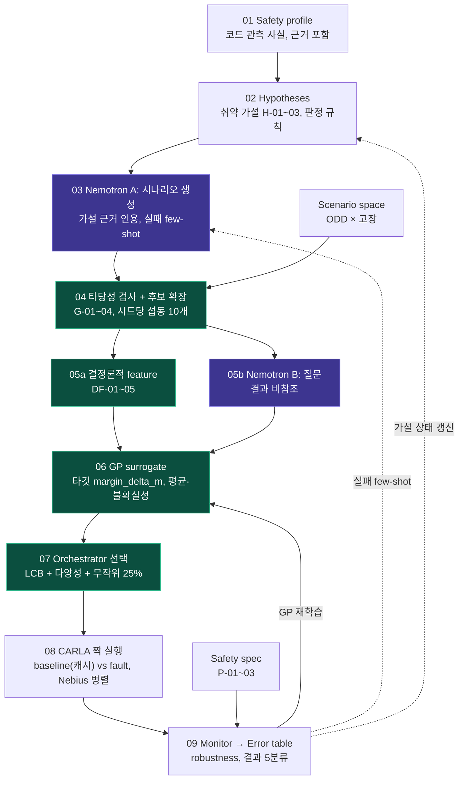

# Code-aware 고장 주입 파이프라인

> 모든 파일은 **템플릿**(`status: template_unverified` / `example_only`)이며 실측값이 아닙니다.

🟪 Nemotron · 🟩 결정론·학습 · ⬜ 파일·시뮬

## 단계별 파일

| 단계 | 파일 | 내용 |
|---|---|---|
| 01 Safety profile | [`01_safety_profile/safety_profile.yaml`](01_safety_profile/safety_profile.yaml) | 코드에서 추출한 관측 사실(O-xxx)과 근거 |
| 02 Hypotheses | [`02_hypotheses/vulnerability_patterns.yaml`](02_hypotheses/vulnerability_patterns.yaml) | 취약 패턴 카탈로그(틀) + 공통 판정 규칙 |
| | [`02_hypotheses/hypotheses.yaml`](02_hypotheses/hypotheses.yaml) | 패턴 × 프로필로 생성된 가설 H-01~03, 상태 추적 |
| 03 Nemotron A | [`03_nemotron_a/nemotron_a.yaml`](03_nemotron_a/nemotron_a.yaml) | 시나리오 후보 생성 (실패 few-shot 입력) |
| 04 타당성 검사 + 후보 확장 | [`04_feasibility_expansion/feasibility_expansion.yaml`](04_feasibility_expansion/feasibility_expansion.yaml) | G-01~04 게이트, 섭동·중복 제거 |
| ↳ Scenario space | [`04_feasibility_expansion/scenario_space.yaml`](04_feasibility_expansion/scenario_space.yaml) | ODD 변수, 고장 F-01~03, 주입 시점 |
| 05a 결정론적 feature | [`05a_deterministic_features/deterministic_features.yaml`](05a_deterministic_features/deterministic_features.yaml) | DF-01~05, GP 입력 구성 |
| 05b Nemotron B | [`05b_nemotron_b/nemotron_b.yaml`](05b_nemotron_b/nemotron_b.yaml) | 코드 질문 Q-B1~3 (결과 비참조) |
| 06 GP surrogate | [`06_gp_surrogate/surrogate.yaml`](06_gp_surrogate/surrogate.yaml) | margin_delta_m 회귀 |
| 07 Orchestrator | [`07_orchestrator/orchestrator.yaml`](07_orchestrator/orchestrator.yaml) | cold start, LCB 획득, 예산·중단 조건 |
| 08 CARLA 짝 실행 | [`08_carla_paired_run/paired_runs.yaml`](08_carla_paired_run/paired_runs.yaml) | CARLA 설정, baseline vs fault 매칭 |
| 09 Monitor | [`09_monitor/error_table.yaml`](09_monitor/error_table.yaml) | run record · failure table 스키마 |
| ↳ Safety spec | [`09_monitor/safety_spec.yaml`](09_monitor/safety_spec.yaml) | P-01~03 robustness, 결과 5분류 |
| 비교 실험 | [`evaluation/ablations.yaml`](evaluation/ablations.yaml) | X-1~5 ablation, 평가 지표 |

## 피드백 루프

| 선 | 경로 | 정의 위치 |
|---|---|---|
| ── GP 재학습 | 09 → 06 | `surrogate.yaml` `feedback_in` |
| ‐ ‐ 실패 few-shot | 09 → 03 | `nemotron_a.yaml` `feedback_in` |
| ┈ 가설 상태 갱신 | 09 → 02 | `hypotheses.yaml` `tracking` |
