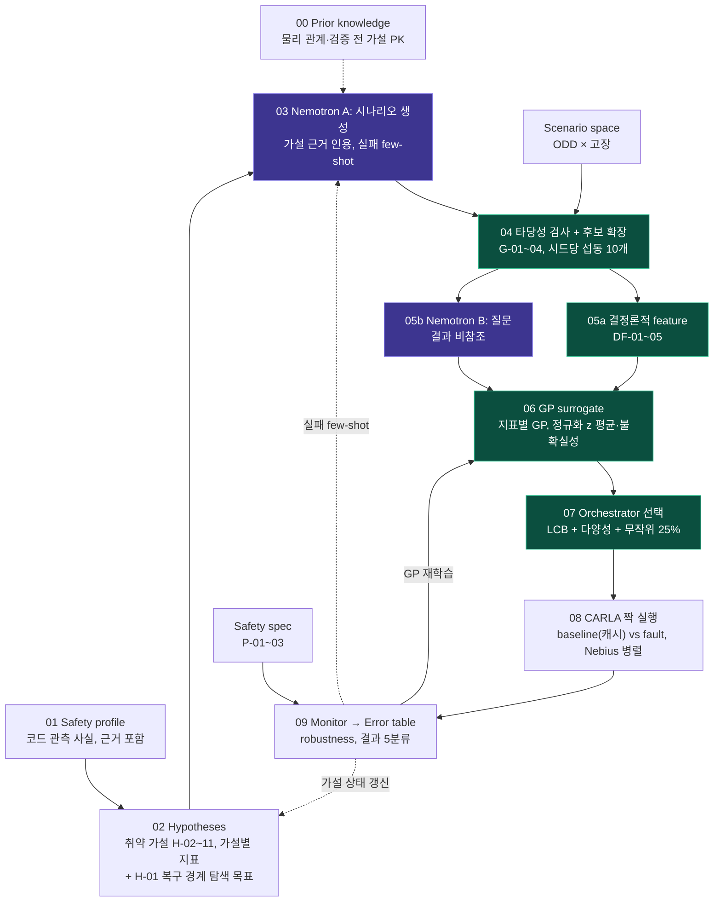

# Code-aware 고장 주입 파이프라인

> 모든 파일은 **템플릿**(`status: template_unverified` / `example_only`)이며 실측값이 아닙니다.



🟪 Nemotron · 🟩 결정론·학습 · ⬜ 파일·시뮬

## 단계별 파일

| 단계 | 파일 | 내용 |
|---|---|---|
| 00 Prior knowledge | [`00_prior_knowledge/prior_knowledge.yaml`](00_prior_knowledge/prior_knowledge.yaml) | 물리 관계 PK-001, 검증 전 가설 PK-002/003 ([`prior_tools`](prior_tools/README.md)) |
| 01 Safety profile | [`01_safety_profile/safety_profile.yaml`](01_safety_profile/safety_profile.yaml) | 코드에서 추출한 관측 사실(O-xxx)과 근거 |
| 02 Hypotheses | [`02_hypotheses/vulnerability_patterns.yaml`](02_hypotheses/vulnerability_patterns.yaml) | 취약 패턴 카탈로그 v2(틀, 11개) + 지표 규칙·GP 타깃 규칙 + 판정 절차 |
| | [`02_hypotheses/hypotheses.yaml`](02_hypotheses/hypotheses.yaml) | 패턴 × 프로필로 생성된 가설 H-02~11, 상태 추적 (자동 생성) |
| | [`02_hypotheses/search_objectives/`](02_hypotheses/search_objectives/) | H-01 LQR 설계점 이탈 복구 경계 **탐색 목표** (새 스키마 초안, 파이프라인 미연결). 옛 H-01 패턴은 `superseded_patterns`로 이동 |
| | [`hypothesis_tools/`](hypothesis_tools/) | 가설 생성기 · 시나리오 후보 샘플러 · 예시 입력 |
| 03 Nemotron A | [`03_nemotron_a/nemotron_a.yaml`](03_nemotron_a/nemotron_a.yaml) | 시나리오 후보 생성 (실패 few-shot 입력) |
| 04 타당성 검사 + 후보 확장 | [`04_feasibility_expansion/feasibility_expansion.yaml`](04_feasibility_expansion/feasibility_expansion.yaml) | G-01~04 게이트, 섭동·중복 제거 |
| ↳ Scenario space | [`04_feasibility_expansion/scenario_space.yaml`](04_feasibility_expansion/scenario_space.yaml) | ODD 변수, 고장 F-01~03, 주입 시점 |
| 05a 결정론적 feature | [`05a_deterministic_features/deterministic_features.yaml`](05a_deterministic_features/deterministic_features.yaml) | DF-01~05, GP 입력 구성 |
| 05b Nemotron B | [`05b_nemotron_b/nemotron_b.yaml`](05b_nemotron_b/nemotron_b.yaml) | 코드 질문 Q-B1~3 (결과 비참조) |
| 06 GP surrogate | [`06_gp_surrogate/surrogate.yaml`](06_gp_surrogate/surrogate.yaml) | 가설 주 지표마다 GP 1개, 방향·스케일 정규화 z 회귀 |
| 07 Orchestrator | [`07_orchestrator/orchestrator.yaml`](07_orchestrator/orchestrator.yaml) | cold start, LCB 획득, 예산·중단 조건 |
| 08 CARLA 짝 실행 | [`08_carla_paired_run/paired_runs.yaml`](08_carla_paired_run/paired_runs.yaml) | CARLA 설정, baseline vs fault 매칭 |
| 09 Monitor | [`09_monitor/error_table.yaml`](09_monitor/error_table.yaml) | run record · failure table 스키마 |
| ↳ Safety spec | [`09_monitor/safety_spec.yaml`](09_monitor/safety_spec.yaml) | P-01~03 robustness, 결과 5분류 |
| 비교 실험 | [`evaluation/ablations.yaml`](evaluation/ablations.yaml) | X-1~5 ablation, 평가 지표 |

## 피드백 루프

| 선 | 경로 | 정의 위치 |
|---|---|---|
| ── GP 재학습 | 09 → 06 | `surrogate.yaml` `feedback_in` |
| ‐ ‐ 실패 few-shot | 09 → 03 | `nemotron_a.yaml` `feedback_in` |
| ┈ 가설 상태 갱신 | 09 → 02 | `hypotheses.yaml` `tracking` |

## 가설 생성 · 지표별 GP 타깃

```bash
# 저장소 루트에서
python -m pipeline.hypothesis_tools.generate_hypotheses          # 01 + 02 카탈로그 + 04 → 02_hypotheses/hypotheses.yaml
python -m pipeline.hypothesis_tools.build_scenario_candidates -o candidates.yaml   # proposed 가설만, CARLA 미검증
python3 scripts/runner_skeleton.py --check                       # null 항목 + 가설 상태 + 활성 GP 지표
python -m unittest discover -s tests -v
```

- H-01은 condition/control 가설이 아니라 복구 경계 탐색 목표다 ([`search_objectives/H-01_lqr_off_design_recovery_boundary.yaml`](02_hypotheses/search_objectives/H-01_lqr_off_design_recovery_boundary.yaml)). 복구 성공·실패를 모두 관측해 경계를 추정하며, 측정된 성공 영역은 수학적 안전 보증이 아니다. 회귀 검증(구버전 vs 신버전)은 별도 개념이다.
- `safety_profile.yaml`이 비어 있으면 10개 가설(H-02~11)이 모두 `blocked`다. 형식 예시는 [`hypothesis_tools/examples/`](hypothesis_tools/examples/)(가상 값)에 있다.
- 가설마다 주 지표가 다르다 (`metric_rules`): `recovery_success`, `pre_switch_max_lateral_error_m`, `switch_count`, `lateral_error_rmse_m`, `deadline_miss_rate`, `mpc_constraint_violation_rate`.
- GP는 활성 지표마다 하나씩 둔다. 타깃 `y`는 고장 런이면 `metric(fault) − metric(baseline)`, 고장이 없는 후보(H-08/H-10/H-11)면 단일 런 값이다. `recovery_success`는 이진값이라 GP는 연속값 `recovery_robustness`(전환 후 `T_hold` 동안 정규화 제약 여유의 최솟값)를 학습한다.
- 지표끼리 비교하기 위해 `z = sign · y / scale`로 맞춘다 (`scale = minimum_effect`, z가 낮을수록 가설 방향). 07은 후보가 인용한 가설 지표의 `mean_z − β·std_z`로 고른다.
- GP 탐색 런은 가설 판정에 쓰지 않는다. 판정은 `decision_protocol`의 전용 무작위 런과 부트스트랩 CI로만 한다.
- 횡가속도 수요가 P-02 임계를 넘는 후보는 버리지 않고 `stress_test`로 태깅한다 (G-03, PK-001).
