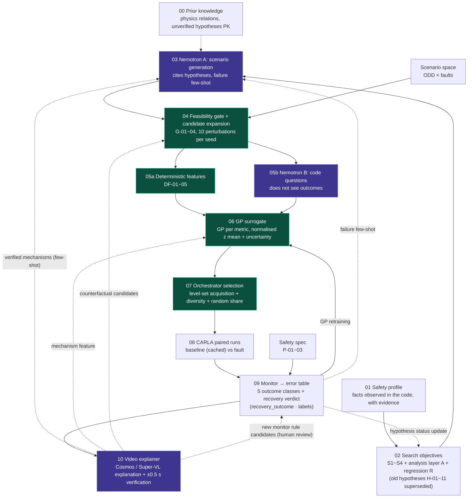

# Code-aware fault injection pipeline

> Config files are **templates** (`status: template_unverified`) unless stated otherwise; their numbers are not measurements.
> 2026-10-27: this folder holds only the stage configs (YAML) and their descriptions. Executable code is in [`engine/`](../engine/) at the repository root; the entry point is [`run.py`](../run.py) (`python run.py --mock`). Usage: repository README, section 9 (Quickstart).



🟪 Nemotron · 🟩 deterministic / learned · ⬜ files / simulation

## Files per stage

| Stage | File | Content |
|---|---|---|
| 00 Prior knowledge | [`00_prior_knowledge/prior_knowledge.yaml`](00_prior_knowledge/prior_knowledge.yaml) | physics relation PK-001, unverified hypotheses PK-002/003 ([`prior_tools`](../engine/prior_tools/README.md)) |
| 01 Safety profile | [`01_safety_profile/safety_profile.yaml`](01_safety_profile/safety_profile.yaml) | observed facts extracted from the code (O-xxx) with evidence |
| 02 Hypotheses | [`02_hypotheses/vulnerability_patterns.yaml`](02_hypotheses/vulnerability_patterns.yaml) | vulnerability pattern catalogue v2 (frame, 11 patterns) + metric rules, GP target rules and decision protocol |
| | [`02_hypotheses/hypotheses.yaml`](02_hypotheses/hypotheses.yaml) | hypotheses generated from patterns × profile (auto-generated); currently empty because no pattern is active |
| | [`02_hypotheses/search_objectives/`](02_hypotheses/search_objectives/) | **S set** (new schema draft, not wired into the pipeline): S1 LQR handover boundary: error at switch × steering saturation (H-01+H-04+H-05+H-09), S2 fault timing and detection delay (H-02+H-06), S3 natural MPC degradation (H-10+H-08+H-11, no fault injection), S4 optional, A switch record common to all runs, R regression checks (H-03 etc.). H-07 on hold. Common rules in `_common.yaml` |
| | [`engine/hypothesis_tools/`](../engine/hypothesis_tools/) | hypothesis generator · scenario candidate sampler · example inputs |
| 03 Nemotron A | [`03_nemotron_a/nemotron_a.yaml`](03_nemotron_a/nemotron_a.yaml) | scenario candidate generation (failure few-shot input) |
| 04 Feasibility gate + expansion | [`04_feasibility_expansion/feasibility_expansion.yaml`](04_feasibility_expansion/feasibility_expansion.yaml) | gates G-01~04, perturbation and de-duplication |
| ↳ Scenario space | [`04_feasibility_expansion/scenario_space.yaml`](04_feasibility_expansion/scenario_space.yaml) | ODD variables, faults F-01~03, injection timing (team template for the hypothesis tools) |
| ↳ av_stack fault list | [`04_feasibility_expansion/scenario_space_av_stack.yaml`](04_feasibility_expansion/scenario_space_av_stack.yaml) | faults F-01~07 × timing × environment (the list the loop actually uses, from sim-eval) |
| 05a Deterministic features | [`05a_deterministic_features/deterministic_features.yaml`](05a_deterministic_features/deterministic_features.yaml) | DF-01~05, GP input layout |
| 05b Nemotron B | [`05b_nemotron_b/nemotron_b.yaml`](05b_nemotron_b/nemotron_b.yaml) | code questions Q-B1~3 (does not see outcomes) |
| 06 GP surrogate | [`06_gp_surrogate/surrogate.yaml`](06_gp_surrogate/surrogate.yaml) | one GP per primary metric, direction / scale-normalised z regression |
| 07 Orchestrator | [`07_orchestrator/orchestrator.yaml`](07_orchestrator/orchestrator.yaml) | cold start, acquisition, budget and stopping rules |
| 08 CARLA paired runs | [`08_carla_paired_run/paired_runs.yaml`](08_carla_paired_run/paired_runs.yaml) | CARLA settings, baseline vs fault matching |
| 09 Monitor | [`09_monitor/error_table.yaml`](09_monitor/error_table.yaml) | run record · failure table schema |
| ↳ Safety spec | [`09_monitor/safety_spec.yaml`](09_monitor/safety_spec.yaml) | P-01~04 (P-02 lateral acceleration and P-04 jerk are labels), mapping of the 5 outcome classes ↔ recovery_outcome |
| ↳ monitor | [`engine/monitor.py`](../engine/monitor.py) | `evaluate(run_dir, spec, baseline_dir=, no_reaction_dir=)` → run_record (CLI: `python -m engine.monitor RUN_DIR --baseline BASE_DIR [--no-reaction DIR]`) |
| ↳ SR checks · screen | [`engine/sr_checks.py`](../engine/sr_checks.py) · [`engine/dashboard.py`](../engine/dashboard.py) | adapter calling SR monitor v3.1 → run_record `sr_*` fields, progress screen HTML |
| ↳ SR monitor v3.1 | [`09_monitor/monitor.py`](09_monitor/monitor.py) · [`09_monitor/README.md`](09_monitor/README.md) | SR1~SR6 scoring (P-02 vs the baseline run, R79-style lateral acceleration and jerk). Exceptionally, executable code lives in this folder |
| 10 Video explainer | [`10_video_explainer/video_explainer.yaml`](10_video_explainer/video_explainer.yaml) | which runs to explain, 4 fps clips, ±0.5 s verification, mechanism tags, feedback |
| LLM models | [`llm_models.yaml`](llm_models.yaml) | A Lightning · A_refine · B Ultra x3 · C Cosmos (dedicated) / Super-VL |
| Execution engine | [`engine/`](../engine/) · [`run.py`](../run.py) (repository root) | judgment, monitor, scenarios, surrogate (sklearn GP + level-set acquisition), llm, nemotron, carla_runner, video, explainer, feedback, boundaries, fixtures (SYNTHETIC) |
| Comparison experiments | [`evaluation/ablations.yaml`](evaluation/ablations.yaml) | X-1~6 ablations (+ video_explainer on/off), boundary-estimation metrics, mock_suite |

## Feedback loops

| Line | Path | Defined in |
|---|---|---|
| ── GP retraining | 09 → 06 | `surrogate.yaml` `feedback_in` |
| ‐ ‐ failure few-shot | 09 → 03 | `nemotron_a.yaml` `feedback_in` |
| ┈ hypothesis status update | 09 → 02 | `hypotheses.yaml` `tracking` |
| ‐ ‐ verified video mechanisms | 10 → 03 | `video_explainer.yaml` `feedback.few_shot_to_A` |
| ‐ ‐ mechanism feature | 10 → 06 | `video_explainer.yaml` `feedback.gp_categorical_features` |
| ‐ ‐ counterfactual re-runs | 10 → 04/07 | `video_explainer.yaml` `feedback.counterfactual_queue` (up to 2 forced per round) |
| ‐ ‐ rule candidates | 10 → 09 (human) | `monitor_rule_candidates.yaml`, never applied automatically |

## Hypothesis generation · GP targets per metric

```bash
# from the repository root
python -m engine.hypothesis_tools.generate_hypotheses          # 01 + 02 catalogue + 04 → 02_hypotheses/hypotheses.yaml
python -m engine.hypothesis_tools.build_scenario_candidates -o candidates.yaml   # proposed hypotheses only, not verified in CARLA
python run.py --check                                            # null entries + hypothesis status + active GP metrics
python -m pytest -q                                              # includes the unittest tests
python run.py --mock                                             # 00 → 10 loop (SYNTHETIC)
```

- The old condition/control hypotheses H-01~11 were all replaced by the S-set search objectives (`superseded_patterns` in `vulnerability_patterns.yaml`, `patterns: []`). The search objectives observe both recovery successes and failures to estimate the boundary; a measured success region is not a mathematical safety guarantee. Regression checks (old vs new version) are a separate concept.
- `safety_profile.yaml` is partly filled from the av_stack code of `junwoo/sim-eval` (9b51151) (O-001~O-025, verified: false).
- The generator itself is tested with the old patterns. Format examples are in [`engine/hypothesis_tools/examples/`](../engine/hypothesis_tools/examples/) (fictional values).
- Each hypothesis has its own primary metric (`metric_rules`): `recovery_success`, `pre_switch_max_lateral_error_m`, `switch_count`, `lateral_error_rmse_m`, `deadline_miss_rate`, `mpc_constraint_violation_rate`.
- There is one GP per active metric. The target `y` is `metric(fault) − metric(baseline)` for fault runs and the single-run value for fault-free candidates (H-08/H-10/H-11). `recovery_success` (= `final_safe_recovery`) is binary, so the GP learns continuous values instead (the final campaign uses `safety_margin`, `run.py --gp-target safety_margin`, see `result/result_12/run_config.json`; earlier: `lane_recovery_robustness`, the normalised minimum lane margin over 3 s after the switch, collision −2, clipped to [−2, 1], and `lat_acc_excess_mps2`, lateral acceleration in excess of the baseline at the same route position).
- To compare metrics, values are aligned as `z = sign · y / scale` (`scale = minimum_effect`; lower z = in the hypothesis direction).
- GP search runs are not used for hypothesis verdicts. Verdicts come only from the dedicated random runs and bootstrap CIs of `decision_protocol`.
- Candidates whose lateral-acceleration demand exceeds the P-02 threshold are not discarded but tagged `stress_test` (G-03, PK-001).

## Post-switch recovery verdict (2026-10-27, numbers PROVISIONAL)

Source definitions: `02_hypotheses/vulnerability_patterns.yaml` `outcome_definitions.recovery_judgment` · common rules `search_objectives/_common.yaml` `recovery_judgment`.

| Outcome (`recovery_outcome`, exactly one) | Meaning |
|---|---|
| `safe_recovery` | no lane departure after the switch + within 3 s, \|e_y\|≤0.3 m and \|e_psi\|≤0.1 rad held continuously for ≥ 1 s |
| `recovered_after_departure` | departed, then returned and settled under the same conditions |
| `unsettled` | no departure, but not settled within 3 s |
| `unrecovered` | collision, or departed and never returned (including returned but never settled, pending decision) |
| `simulation_invalid` / `no_switch` | incomplete window or no data / no switch (no_trigger, triggered_no_switch in the 5 outcome classes) |

- Labels (several possible): `lat_acc_excess` (4.41 m/s² above the baseline), `lat_jerk_excess` (15 m/s³ in the final safety_spec, previously 5 m/s³; 0.5 s moving average), `departed_at_switch`, `safe_stop`. Each has a primary version (vs the baseline at the same route position) and a secondary one (absolute value).
- Final `final_safe_recovery = safe_recovery AND NOT lat_acc_excess.primary AND NOT lat_jerk_excess.primary` → `switched_safe` in the 5 outcome classes.
- Changed to the team's criteria on 2026-10-27: lateral acceleration 4.41 m/s² (= 0.5·μ·g, μ 0.9), recovery window 3 s (SR5 within_s), collision −2. All values are read from `09_monitor/safety_spec.yaml`. The earlier 3 m/s² was a reference value from ISO 11270:2014 / UN R79 supplied by the user (original text not checked). These are LKAS values with a driver in the loop, not certification limits. CARLA a_y includes the path-curvature demand, so the primary version uses the difference to the baseline.
- 0.3 m / 0.1 rad are to be replaced by p95 + margin of the same segment in fault-free MPC runs (`av_stack/runs/fault_check_1027`).
- Baseline position alignment currently uses the approximation `s = cumsum(vx·dt)`. Exact alignment needs route-index logging in monitor_probe (L-5).
